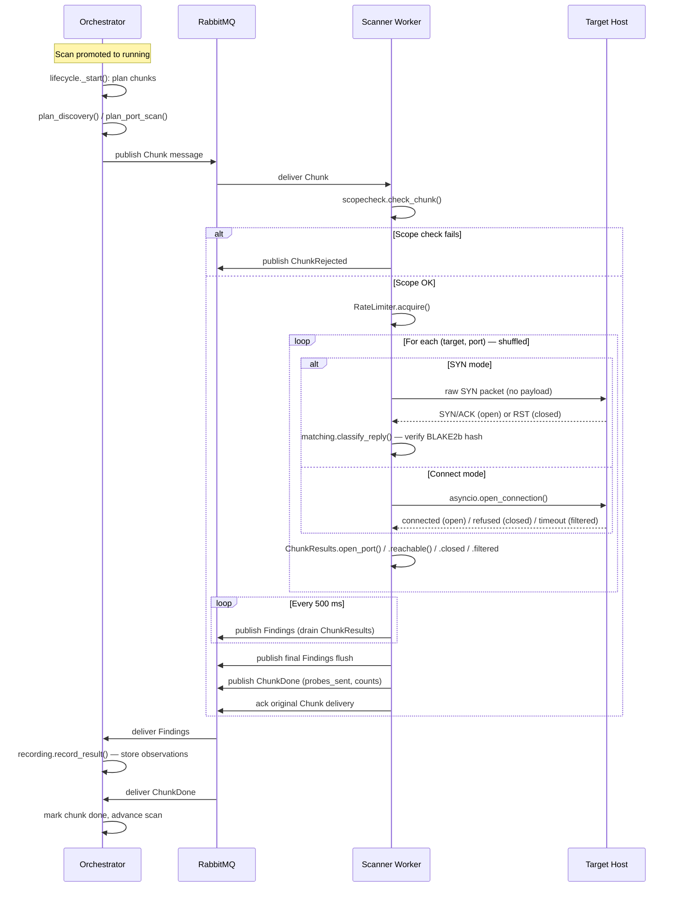
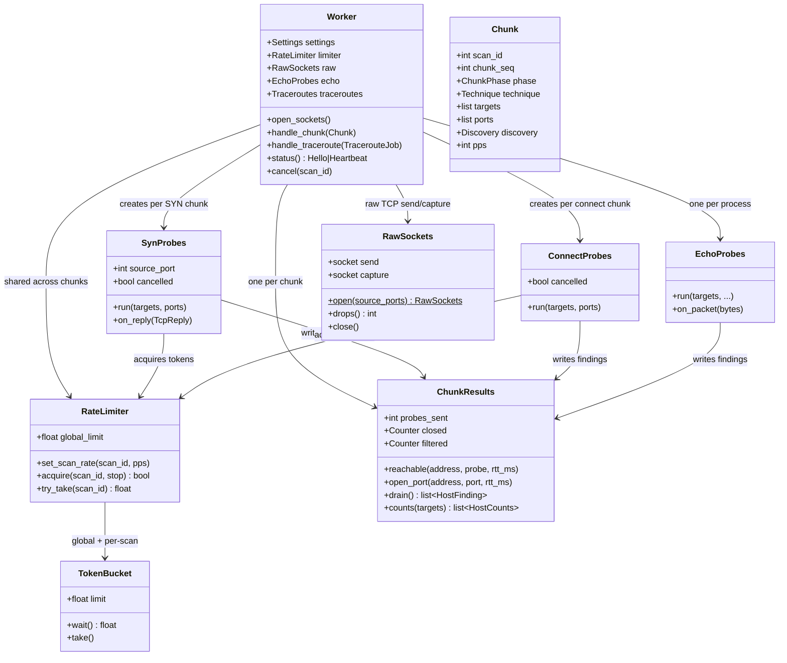
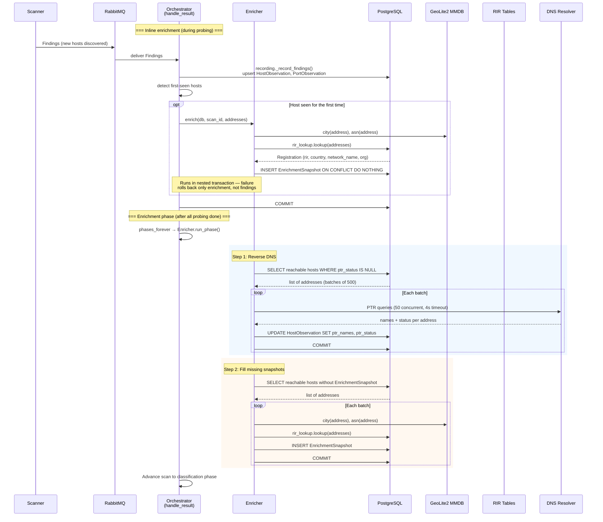
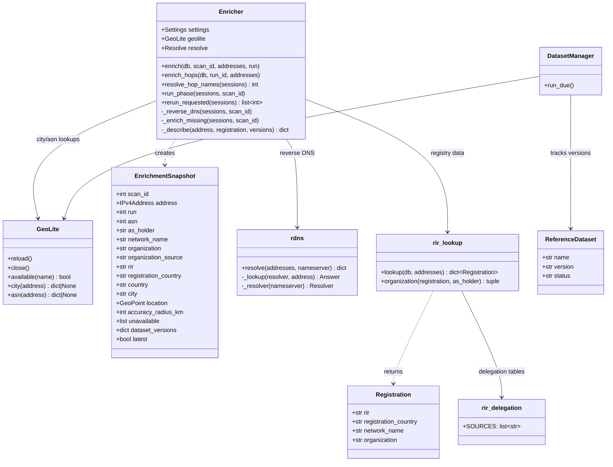
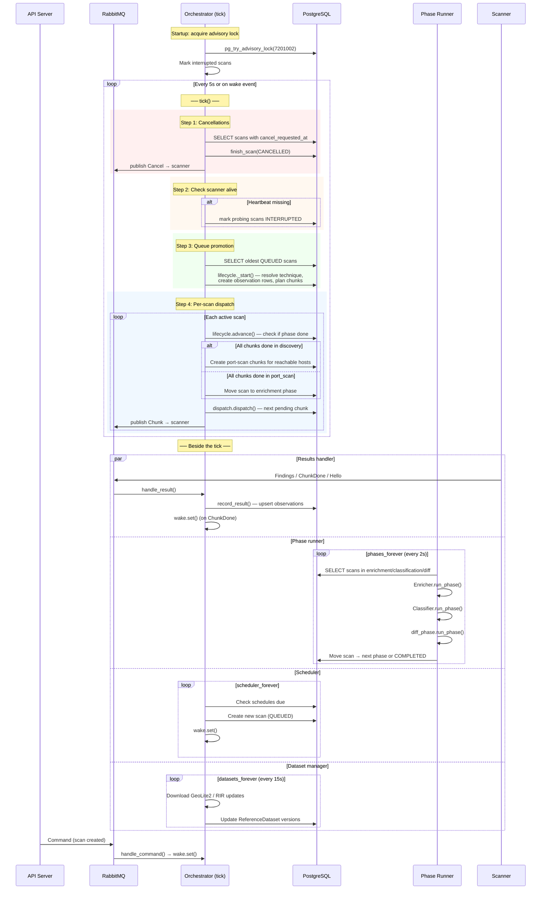
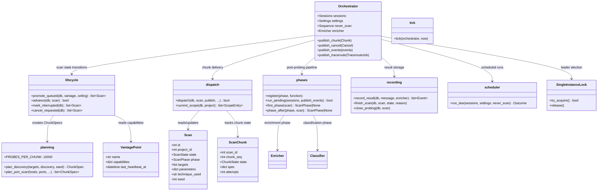

# Network Discovery Map — Backend

## Architecture overview

The backend has three processes that communicate through RabbitMQ:

- **API** (`ndm.api`) — a FastAPI server. Accepts scan requests, serves results, manages projects and schedules.
- **Orchestrator** (`ndm.orchestrator`) — the single brain. Plans scans, dispatches chunks, records results, runs enrichment and classification, watches schedules.
- **Scanner** (`ndm.scanner`) — a stateless worker. Receives chunks, sends probes, publishes findings. Has no database; everything it needs arrives in the chunk message, and everything it knows leaves through the broker.

```
API  ──(command)──►  Orchestrator  ──(chunk)──►  Scanner
                     ◄──(findings/done)──┘
                     │
                     ▼
                  PostgreSQL
```

---

## 1. How the scanner works — from chunk to probe

### Scanner sequence diagram



### Scanner classes involved



### Planning: how a scan becomes chunks

When a scan is promoted from `queued` to `running`, the orchestrator's `lifecycle._start` creates the initial chunks:

1. **Target list** — the scan carries the IP addresses from the project scope.
2. **Discovery chunk** (optional) — if the scan profile includes host discovery, `planning.plan_discovery` creates chunk 0 with all targets and the selected discovery methods (ICMP echo, TCP probes on specific ports).
3. **Port-scan chunks** — `planning.plan_port_scan` cuts the work into units of ~10 000 probes each. Hosts are grouped (default 64 per group), ports are sliced to fit the budget, and both are shuffled with a deterministic seed. Each chunk gets a `chunk_seq` number.

A chunk message (`Chunk`) carries everything the scanner needs: targets, ports, technique (SYN or connect), rate limit, timeout, retries, the scan seed, the current scope, and the attestation that proves the scope was reviewed.

### Dispatch: one chunk at a time

The orchestrator's `tick` runs every 5 seconds (or immediately when a broker message wakes it). For each active scan, `dispatch.dispatch` sends **one chunk at a time** via the broker. A chunk has a lease (at least 5 minutes, or 3× its expected duration); if the scanner doesn't answer in time, the same chunk is re-dispatched, up to 5 attempts before the scan fails.

### Scanner startup

`ndm.scanner.start` checks whether the container has `CAP_NET_RAW` in its bounding set. If so, it re-execs the scanner on `python-netraw` (an interpreter with the file capability), which enables SYN scanning and ICMP echo. Without it, the scanner falls back to connect scanning.

On startup, `Worker.open_sockets` tries to open:
- A **raw TCP socket pair** (send + capture) for SYN probes — replies are received on the capture socket via the event loop.
- A **raw ICMP socket** for echo requests and traceroute TTL-exceeded replies.

The scanner sends a `Hello` message with its capabilities (`syn_capable`, `icmp_capable`) and a `Heartbeat` every 10 seconds.

### Scope check

Before the first probe, the scanner runs its own scope check (`scopecheck.check_chunk`). Every target is verified against:
- The scope carried in the chunk message.
- The scanner's own never-scan list (from its environment).
- The non-public address space rules (unless `NDM_ALLOW_NON_PUBLIC_TARGETS` is set).

A chunk that fails the check is rejected — no packets are sent.

### Probing

Each chunk is handled by `Worker.handle_chunk`:

**Discovery mode** (`discovery.discover`):
- Runs ICMP echo pings and TCP probes to specified ports **in parallel** (`asyncio.gather`).
- ICMP: `EchoProbes` sends echo requests, matches replies by identifier and sequence number. A reply means the host is reachable.
- TCP: the same SYN or connect prober is used in discovery mode — any response (SYN/ACK or RST) counts as reachable.

**Port scan mode** (`SynProbes.run` or `ConnectProbes.run`):

- **SYN scan** — each chunk in flight gets its own source port. Probes are raw SYN packets with no payload. The sequence number is a keyed BLAKE2b hash of (target, port), so replies are verified statelessly — no table of pending probes is needed for matching. SYN/ACK = open, RST = closed, silence after retries = filtered. The host kernel's automatic RST to a SYN/ACK closes the half-open connection.
- **Connect scan** — full TCP connections via `asyncio.open_connection`, up to 256 concurrent. Connected = open, refused = closed, timeout = filtered. Nothing is sent after the handshake; the connection is closed immediately.

Both modes:
- Shuffle the (target, port) pairs before sending (randomized scan order).
- Respect the rate limiter — a dual token-bucket system enforces both the per-scan rate and the global operator ceiling.
- Retry unanswered probes up to `retries` times, waiting `timeout_ms` between rounds.
- Support cancellation — a cancelled chunk stops sending and returns what it has.

### Results flow

- `ChunkResults` collects open ports, reachable evidence, and closed/filtered counts.
- Every **500 ms**, the worker drains new findings and publishes a `Findings` message (a list of `HostFinding`, each with its address, evidence, and open ports).
- When all probes are done, a final `Findings` flush is followed by a `ChunkDone` message with the probe count and per-host closed/filtered tallies.
- The chunk's broker message is **acknowledged only after `ChunkDone` is published**, so a crash replays at most one chunk.

---

## 2. Enrichment — when and what

### Enrichment sequence diagram



### Enrichment classes involved



Enrichment happens at **two points**:

### 2a. Inline enrichment (as findings arrive)

When the orchestrator records a `Findings` message in `recording._record_findings`, every host that is **seen for the first time** (newly reachable) gets an enrichment snapshot immediately, in the same database transaction. This is so the host can be drawn on the map at once.

The inline enrichment runs inside a nested transaction (`db.begin_nested()`). If it fails, only the enrichment is rolled back — the finding itself is still recorded, and the enrichment phase fills it in later.

### 2b. The enrichment phase (after all probing is done)

Once the last chunk is done, the scan moves through post-probing phases in order:

```
probing → enrichment → classification → diff → completed
```

The enrichment phase (`Enricher.run_phase`) does two things:

1. **Reverse DNS** — for every reachable host that hasn't been looked up yet, a PTR query is sent to the configured resolver (or skipped if `ptr_enabled` is false). Lookups run in batches of 500 addresses, 50 concurrent queries, with a 4-second lifetime per query.

2. **Fill missing snapshots** — any reachable host that still has no enrichment snapshot (missed inline enrichment, or the phase was interrupted and restarted) gets one now.

### What enrichment contains

Each enrichment snapshot (`EnrichmentSnapshot`) stores, for one address at one point in time:

| Field | Source |
|---|---|
| Country, city, coordinates, accuracy radius | GeoLite2 City (MaxMind MMDB) |
| ASN, AS holder | GeoLite2 ASN (MaxMind MMDB) |
| RIR, registration country | RIR delegation statistics (AFRINIC, APNIC, ARIN, LACNIC, RIPE NCC) |
| Network name, organization | RIR WHOIS-like object records (inetnum) |
| PTR names, PTR status | Reverse DNS lookup |

If a dataset is missing or stale, the affected fields are listed as `unavailable` (not empty — an explicit distinction). The organization falls back to the AS holder when the registry has no record.

All enrichment is **local** — GeoLite2 and RIR data are pre-downloaded databases. The only external query is reverse DNS, and it can be turned off. No per-address API call is made to any third-party service.

### Re-runs

An analyst can request re-enrichment of a finished scan. This creates a new snapshot with the next `run` number for every reachable host, using the latest reference data. Earlier snapshots are unchanged.

### Traceroute hop enrichment

When traceroute hops are recorded, responding intermediate routers are enriched with the same GeoLite2/RIR data (`Enricher.enrich_hops`). Their reverse DNS is resolved separately in the phase runner loop, so a slow resolver doesn't block scan results.

---

## 3. How the orchestrator works

### Orchestrator sequence diagram



### Orchestrator classes involved



The orchestrator is a **single-instance** process. It acquires a PostgreSQL advisory lock at startup; a second instance waits idle until the first dies.

### The tick loop

The core is a **tick** that runs every 5 seconds (or immediately when a broker message wakes it). Each tick:

1. **Cancellations** — scans whose cancellation or deletion was requested are ended. A `Cancel` message is published to tell the scanner to stop sending.
2. **Failed scheduled runs** — an alert is raised for each scheduled scan that failed since the last tick.
3. **Interruption** — if the scanner's heartbeat is missing, all probing scans are marked `interrupted`. They return to `running` with their next finding.
4. **Queue promotion** — the oldest queued scans are started (up to `max_concurrent_scans`), technique is resolved from the scanner's capabilities, observation rows are created, and the first chunks are planned.
5. **Traceroute dispatch** — traceroute jobs have their own ceiling and queue, independent of scan dispatch.
6. **Per-scan dispatch** — for each active scan, `lifecycle.advance` checks whether the current phase's chunks are all done. If so, it transitions the scan (discovery → port scan → enrichment → ...). Then `dispatch.dispatch` sends the next chunk if the scan is still probing and the scanner is alive.

### Message handling (beside the tick)

The orchestrator consumes three broker queues, each in its own callback:

- **Results queue** (prefetch 1, in order) — `Findings` are recorded as host observations and port observations. `ChunkDone` marks a chunk done. `ChunkRejected` fails the scan. `Hello`/`Heartbeat` update the vantage point's status and capabilities.
- **Commands queue** — API commands (e.g., "a scan was created") simply wake the tick.
- **Dead-letter queue** — messages that failed all delivery attempts. The orchestrator fails the affected scan or traceroute and raises an alert.

### Concurrent loops

Beside the tick, four long-lived tasks run:

| Task | What it does | Interval |
|---|---|---|
| `phases_forever` | Runs the enrichment → classification → diff pipeline for scans that finished probing. Also handles enrichment re-run requests and traceroute hop DNS. | 2 s when idle |
| `purge_forever` | Removes rows of deleted scans and projects. | 60 s |
| `scheduler_forever` | Starts scheduled scans that are due. | configurable |
| `datasets_forever` | Keeps GeoLite2 and RIR reference datasets up to date by downloading new versions. | 15 s |

### Scan lifecycle

```
queued → running (discovery → port_scan → enrichment → classification → diff) → completed
              │      ▲
              │      └── interrupted (scanner heartbeat lost; resumes on next finding)
              ├──► cancelled (analyst requested; results kept, partial)
              └──► failed (scope changed, chunk lost, phase error; results kept, partial)
```

- A scan that **failed in a phase** (enrichment, classification, diff) can be retried by the analyst — only the failed phase and those after it are re-run; probing is not repeated.
- Each phase function is **idempotent** — running it again after a crash changes nothing, because writes use `ON CONFLICT DO NOTHING` or equivalent guards.

### Classification phase

After enrichment, every discovered host is classified by a YAML ruleset. Inputs: open ports, PTR names, enrichment attributes, whether the address was seen as a traceroute hop. Output: a device type (e.g., router, server, firewall) with a confidence score and optional sub-role.

### Diff phase (scheduled scans only)

A scheduled scan is compared with the previous completed run of the same schedule. The diff records new hosts, gone hosts, new/gone ports, and changed classifications. If anything changed, an alert is raised.

---

## Running the scanner standalone

You can run the scanner against one IP without the orchestrator or database, using [scripts/scan_one.py](scripts/scan_one.py).

From `Assesment/`, with the lab running (`docker compose -f deploy/lab/compose.lab.yaml up -d`):

```sh
# SYN scan, inside the dev scanner container (host network + NET_RAW)
docker compose -f deploy/compose.dev.yaml run --rm \
  -v "$PWD/backend/scripts:/scripts:ro" scanner \
  python-netraw /scripts/scan_one.py 10.77.3.10 --ports 22,80,443 --syn
```

Options:
- `--ports`: a list like `22,80,8000-8100`, or one of the profiles `top-100` (the default), `top-1000` or `full`.
- `--syn`: SYN scan. Without it you get a connect scan.
- `--discovery`: runs host discovery (ICMP echo plus TCP probes to `--ports`) instead of a port scan.
- `--pps`, `--timeout-ms`, `--retries`: the same settings a scan has.

Two variations:
- **Connect mode:** use `python` instead of `python-netraw`. The container then runs without raw sockets, the same as a scanner that lacks `NET_RAW`.
- **Skip the dependencies:** add `--no-deps` and Compose won't start RabbitMQ and the firewall-rule container.

Because the code is mounted from `backend/src`, scanner changes apply on the next run without a rebuild.

## Notes

- **Leftovers:** the lab containers and the dev RabbitMQ may still be running. `docker compose -f deploy/compose.dev.yaml down` stops RabbitMQ.
- **Warning:** every run warns that `net.core.rmem_max` is 4194304. Harmless for one host.
- **Private addresses:** private addresses like the lab or `127.0.0.1` are accepted only because the dev stack sets `NDM_ALLOW_NON_PUBLIC_TARGETS=true`.
- **With results stored:** if you want the results saved and shown on the map, run the full dev stack and create a project with a `/32` scope, e.g. `10.77.3.10/32`.
