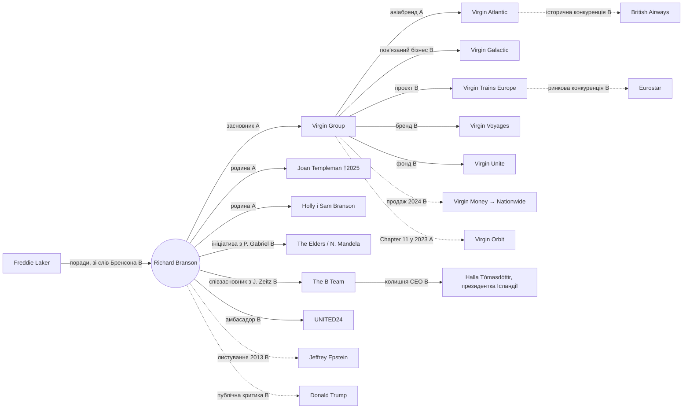

# OSINT-досьє: сер Річард Бренсон

**Інформаційний зріз:** 4 листопада 2026 року. **Мета:** навчальна перевірка публічної біографії, діяльності та комунікації. **Межі:** відкриті джерела; приватні адреси, контакти та дані непублічних осіб не збиралися.

## 1. Суб’єкт

**Річард Чарльз Ніколас Бренсон** (18 липня 1950 року) — британський підприємець, **засновник Virgin Group**. Саме засновником, а не генеральним директором усіх компаній з брендом Virgin, його називають [Virgin](https://www.virgin.com/branson-family/richard-branson), [National Portrait Gallery](https://www.npg.org.uk/collections/search/person/mp06548/sir-richard-charles-nicholas-branson) та [LinkedIn](https://www.linkedin.com/in/rbranson). Дата народження узгоджується у [CNN](https://keyt.com/news/national-world/cnn-world/2024/07/03/richard-branson-fast-facts-3/) і [Forbes](https://www.forbes.com/profile/richard-branson/). **Grade A** для імені, дати та ролі; нинішні виконавчі повноваження не встановлено.

Публічно зазначена основна резиденція — Necker Island, Британські Віргінські острови (**B**; це не висновок про юридичне резидентство чи поточне місцеперебування). Бренд Virgin охоплював музику, авіацію, подорожі та космічні проєкти; конкретні компанії мають різну історію й структуру власності. Джоан Бренсон померла у 2025 році (**A**); нині живі діти — Голлі та Сем (**A**). [Forbes](https://www.forbes.com/profile/richard-branson/), [Virgin](https://www.virgin.com/branson-family/richard-branson), [AP](https://apnews.com/article/9faac6930d67293967b46d1027b91c96).

## 2. Методологія

**Шкала:** **A** — первинний документ і незалежне підтвердження або два незалежні надійні джерела; **B** — надійне першоджерело чи одне сильне незалежне джерело; **C** — непрямі, суперечливі або неперевірені дані; **D** — підстав для твердження немає. Публікації Virgin, її фондів та акаунтів не рахуються трьома незалежними свідченнями. Оцінка факту відрізняється від упевненості у психологічному висновку.

**Хід дослідження.** Фаза 1: зіставлено пошукові результати, біографії, корпоративну хронологію й документи; Wikipedia використано лише як покажчик. Фаза 1.5: [журнал попереднього дослідження](OSINT_Research_Log.md) фіксує два пошуки Google Drive без збігів — це обмеження вибірки, а не доказ відсутності внутрішніх матеріалів. Фаза 2: проаналізовано LinkedIn, Instagram, відео TED/YouTube та блог Virgin; X перевірено лише на рівні ідентифікатора. Фаза 3: ключові твердження зіставлено у таблиці нижче. Фази 4–6: синтез, психопрофіль і оцінка глибини. Окремі Perplexity, Brave, Exa, Tavily та Jina у документованих циклах не запускалися; назви моделей і збіг їхніх відповідей не є незалежними джерелами.

### Таблиця ідентифікаторів

| Майданчик | Атрибуція та доступ | Результат |
|---|---|---|
| [LinkedIn](https://www.linkedin.com/in/rbranson) | **B**: профіль пов’язаний з Virgin; гостьовий перегляд | 9 видимих постів і 1 стаття, [реєстр URL](OSINT_Research_Log.md) |
| [Instagram](https://www.instagram.com/richardbranson/) | **B**: `@richardbranson` пов’язаний з офіційними матеріалами; пряме читання обмежене | Теми та метрики переважно через агрегатор, **C** |
| [TED / YouTube](https://www.youtube.com/watch?v=DudfBIxw6do) | **A**: особу і виступ підтверджує [TED](https://www.ted.com/talks/richard_branson_life_at_30_000_feet?view=transcript); канал належить TED | Одне відео з транскриптом, не особистий канал Бренсона |
| [Блог Virgin](https://www.virgin.com/branson-family/richard-branson-blog) | **B**: офіційний корпоративний майданчик | Авторські тексти й самопрезентація |
| [X](https://x.com/richardbranson) | **B** для ідентифікатора; повна стрічка недоступна | У контентний корпус не включено |
| Telegram | **D**: авторський канал не атрибутовано | Сторонні канали не приписувалися Бренсону |

**Перевірка збігів:** профілі зі схожим іменем, зокрема [інший Richard Branson у LinkedIn](https://www.linkedin.com/in/richard-branson-474082207) та [@RichardMBranson у X](https://x.com/RichardMBranson), відкинуто за невідповідністю професійного контексту. Самого імені чи аватара для атрибуції недостатньо.

## 3. Ключові знахідки

### 3.1 Кар’єрна хронологія

| Період | Подія | Grade / джерело |
|---|---|---|
| 1960-ті | Журнал *Student*; точний рік початку й вік виходу зі школи розходяться | **B** для проєкту, **C** для дат; [Virgin](https://www.virgin.com/about-virgin/timeline), [Biography.com](https://www.biography.com/business-leaders/richard-branson) |
| 1970–1973 | Поштова торгівля платівками → магазин (1971) → студія (1972) → лейбл (1973) | **A** для початку бізнесу за [Virgin](https://www.virgin.com/about-virgin/timeline) і [National Portrait Gallery](https://www.npg.org.uk/collections/search/person/mp06548/sir-richard-charles-nicholas-branson); **B** для послідовності за Virgin; точне датування лейблу — **C** |
| 1984; 1992 | Запуск Virgin Atlantic; продаж Virgin Records | **A**; [Virgin](https://www.virgin.com/about-virgin/timeline), [National Portrait Gallery](https://www.npg.org.uk/collections/search/person/mp06548/sir-richard-charles-nicholas-branson) |
| 1999–2000 | Оголошення лицарства наприкінці 1999-го; церемонія у 2000-му | **A**; [The Gazette](https://www.thegazette.co.uk/London/issue/55710/supplement/1/data.pdf), [архівне фото](https://www.gettyimages.co.uk/detail/news-photo/sir-richard-branson-after-he-was-knighted-by-the-prince-of-news-photo/1819260780) |
| 2004; 2013 | Virgin Unite; співзаснування The B Team | **B**; [Virgin](https://www.virgin.com/branson-family/richard-branson), [The B Team](https://www.bteam.org/who-we-are/our-history) |
| 2007 | Допоміг започаткувати The Elders разом з Пітером Ґебріелом і Нельсоном Манделою; сам не названий членом групи | **B**; [The Elders](https://theelders.org/news/nelson-mandela-and-desmond-tutu-announce-elders) |
| 2021; 2023 | Суборбітальний політ на VSS Unity; процедура Chapter 11 Virgin Orbit | **A**; [Reuters](https://www.investing.com/news/world-news/billionaire-branson-soars-to-space-aboard-virgin-galactic-flight-2554769), [SEC](https://www.sec.gov/Archives/edgar/data/1843388/000162828023020874/vorb-20230602.htm) |
| 2023; 2024 | Амбасадор UNITED24; продаж Virgin Money компанії Nationwide | **B** для першого, **B** для другого; [UNITED24](https://u24.gov.ua/ambassador/richard_branson), [Forbes](https://www.forbes.com/profile/richard-branson/) |

### 3.2 Перехресна перевірка ключових фактів

У таблиці «два джерела» означає два посилання для перевірки; для **B/C** їхня незалежність або точність обмежена. Усі датовані факти описують подію свого часу, а не обов’язково поточний стан.

| Факт | Підтвердження | Grade / межа |
|---|---|---|
| Повне ім’я, дата народження, британське громадянство | [CNN](https://keyt.com/news/national-world/cnn-world/2024/07/03/richard-branson-fast-facts-3/); [Forbes](https://www.forbes.com/profile/richard-branson/) | **A**; довідки, не актовий запис |
| Засновник Virgin Group; компанія описує себе як інвестиційну групу | [Virgin Group](https://www.virgin.com/about-virgin/virgin-group/overview); [National Portrait Gallery](https://www.npg.org.uk/collections/search/person/mp06548/sir-richard-charles-nicholas-branson) | **A** для заснування; **B** для поточної самохарактеристики групи |
| Навчався у Stowe School; повну середню освіту не завершив | [Old Stoic Society, 2017](https://www.stowe.co.uk/getmedia/c06cc64b-b287-444f-a11c-d5554eb6c2eb/Old-Stoic-Society-Accounts-2017-FINAL); [Forbes](https://www.forbes.com/profile/richard-branson/) | **A** для Stowe; **B** для статусу навчання |
| Публічно зазначена основна резиденція — Британські Віргінські острови / Necker Island | [Virgin](https://www.virgin.com/branson-family/richard-branson); [Forbes](https://www.forbes.com/profile/richard-branson/) | **B**; юридичне резидентство й теперішнє місцеперебування не перевірено |
| 1970: поштова торгівля платівками Virgin; 1973: запуск лейблу | [Virgin, хронологія](https://www.virgin.com/about-virgin/timeline); [CNN](https://keyt.com/news/national-world/cnn-world/2024/07/03/richard-branson-fast-facts-3/) | **A** для початку бізнесу; **C** для точного «року заснування лейблу» через розбіжність термінів |
| 1984: Virgin Atlantic; 1992: продаж Virgin Records | [Virgin, хронологія](https://www.virgin.com/about-virgin/timeline); [National Portrait Gallery](https://www.npg.org.uk/collections/search/person/mp06548/sir-richard-charles-nicholas-branson) | **A** для подій; мотив продажу з цих джерел не доведений |
| 2004: створення Virgin Unite; 2013: співзаснування The B Team з Йохеном Цайцом | [Virgin](https://www.virgin.com/branson-family/richard-branson); [The B Team](https://www.bteam.org/who-we-are/our-history) | **B**: твердження організацій-учасниць |
| 11 липня 2021 року: політ на VSS Unity | [Virgin](https://www.virgin.com/branson-family/richard-branson); [Reuters через Investing.com](https://www.investing.com/news/world-news/billionaire-branson-soars-to-space-aboard-virgin-galactic-flight-2554769) | **A**; політ був суборбітальним |
| 2023: Virgin Orbit почала процедуру Chapter 11 і продала активи | [SEC Form 8-K](https://www.sec.gov/Archives/edgar/data/1843388/000162828023020874/vorb-20230602.htm); [Forbes](https://www.forbes.com/profile/richard-branson/) | **A**; це не банкрутство всієї Virgin Group |
| З квітня 2023 року — амбасадор UNITED24 | [UNITED24](https://u24.gov.ua/ambassador/richard_branson); [Virgin, про візит](https://www.virgin.com/branson-family/richard-branson-blog/visiting-ukraine) | **B**: підтвердження сторін-учасниць |
| 2025: смерть дружини Джоан; двоє нині живих дітей — Голлі та Сем | [AP](https://apnews.com/article/9faac6930d67293967b46d1027b91c96); [Virgin](https://www.virgin.com/branson-family/richard-branson) | **A**; біографія Virgin містить застаріле формулювання про спільне проживання |
| Оцінка статків близько **$2,8 млрд** на 3 листопада 2026 року | [Forbes](https://www.forbes.com/profile/richard-branson/) | **B**; змінна оцінка, не аудована сума |

**Уточнення суперечностей.** Місце народження у джерелах різниться: [CNN](https://keyt.com/news/national-world/cnn-world/2024/07/03/richard-branson-fast-facts-3/) вказує Surrey, [Encyclopedia.com](https://www.encyclopedia.com/people/social-sciences-and-law/business-leaders/richard-branson) — Shamley Green, Surrey, а [Wikipedia](https://en.wikipedia.org/wiki/Richard_Branson) — Blackheath, London. [Спогади Бренсона](https://www.theguardian.com/lifeandstyle/2014/sep/19/richard-branson-my-family-values) про дитинство у Shamley Green не встановлюють місця народження. Тому точне місце — **C**, у профілі не фіксується. Вік виходу зі школи — 15 у [TED](https://www.ted.com/talks/richard_branson_life_at_30_000_feet?view=transcript), 16 у [Biography.com](https://www.biography.com/business-leaders/richard-branson): **C**. [Virgin](https://www.virgin.com/about-virgin/timeline) розрізняє магазин 1971-го, студію 1972-го й лейбл 1973-го; інші довідки іноді називають їх узагальнено «Virgin Records». Лицарство внесено до [списку нагород, опублікованого 31.12.1999](https://www.thegazette.co.uk/London/issue/55710/supplement/1/data.pdf), а церемонію датовано [30.03.2000 на архівному фото](https://www.gettyimages.co.uk/detail/news-photo/sir-richard-branson-after-he-was-knighted-by-the-prince-of-news-photo/1819260780) — це різні етапи, не дві дати однієї події.

### 3.3 Граф зв’язків

**Докази ребер:** зв’язки Virgin з бізнесами — [хронологія групи](https://www.virgin.com/about-virgin/timeline) і [Forbes](https://www.forbes.com/profile/richard-branson/); The Elders — [їхнє повідомлення про заснування](https://theelders.org/news/nelson-mandela-and-desmond-tutu-announce-elders); The B Team і колишня CEO — [історія](https://www.bteam.org/who-we-are/our-history) та [повідомлення організації](https://www.bteam.org/our-thinking/news/celebrating-courageous-leadership-halla-t%C3%B3masd%C3%B3ttir-is-elected-president-of-iceland); поточна посада Галлі — [офіс президента Ісландії](https://www.forseti.is/en/president/halla-tomasdottir); Freddie Laker — [розповідь Бренсона](https://www.virgin.com/branson-family/richard-branson-blog/what-if-travelling-by-plane-could-be-fun-the-story-of-virgin-atlantic); UNITED24 — [офіційна сторінка](https://u24.gov.ua/ambassador/richard_branson); конкуренція з Eurostar — [Virgin](https://www.virgin.com/branson-family/richard-branson-blog/all-abroad-virgin-is-on-track-to-launch-a-rival-train-service-through-the); критика Трампа — [авторський допис у LinkedIn](https://www.linkedin.com/posts/rbranson_yesterday-i-thought-that-nobody-could-trump-activity-7515451258703372288-VD5L). [AP повідомила](https://apnews.com/article/682447e50bf9a3643a36c9b54ccdfa22) про листування з Епштейном; оригінали листів тут не перевірено, і сам факт листування не доводить причетності до злочинів. Із вихідного графа вилучено відсоток частки Virgin Galactic та згадку Musk Starshield через брак належного підтвердження.

### 3.4 Платформна витяжка

**LinkedIn.** [Вибірка 10 текстів](OSINT_Research_Log.md) містить теми наставництва, конкурентного бізнесу, політики, гуманітарних подій і бренду. [Стаття від 16.06.2026](https://www.linkedin.com/pulse/time-i-ripped-my-trousers-jumping-off-tallest-building-branson-pwz1c) описує власний помилковий рекламний трюк та потребу у фахівці. Спостереження за цією доступною вибіркою — **B**; вона не репрезентує всю стрічку. У ручному підрахунку emoji є в 1 із 10 текстів; це **C** як узагальнення стилю акаунта. Гостьовий профіль не дав повної історії посад або надійних дат для всіх постів.

**Instagram.** [Pikory](https://pikory.com/u/richardbranson/215712317) показує 12 записів, 4 989 165 підписників і водночас «0 posts» у шапці. За збереженою [вибіркою CSV](Instagram_Engagement_Sample.csv), умовний engagement rate за взаємодіями становить `102 511 / (12 × 4 989 165) × 100 = 0,1712%`. **Grade C:** арифметика відтворювана, вихідні числа не звірені з Instagram; показник не є нативним ER і не узагальнюється на весь акаунт. Теми агрегованих підписів — родина, Virgin, пригоди; геотеги та зв’язки за ними не встановлювалися. Порівняння emoji з LinkedIn неможливе без однаково зібраних нативних підписів.

### 3.5 Психопрофіль

**Відео й довгі розмови.** Для [TED2007](https://www.ted.com/talks/richard_branson_life_at_30_000_feet?view=transcript) є транскрипт інтерв’ю; [ReThinking з Адамом Ґрантом, 2024](https://www.ted.com/podcasts/www.ted.com/podcasts/richard-branson-on-saying-yes-now-and-figuring-it-out-later-transcript) і [Tim Ferriss Show, 2018](https://tim.blog/2018/02/02/the-tim-ferriss-show-transcripts-sir-richard-branson/) додають довший мовний контекст. У цих розмовах він описує пошук можливостей, увагу до людей, готовність ризикувати й делегувати. **B** для зафіксованих висловлювань, **низька або середня впевненість** для висновку про сталу особисту рису: це публічна, можливо редагована самопрезентація. Блог Virgin також належить до контрольованих суб’єктом джерел.

| Вісь MBTI | Обережна гіпотеза та доказ | Впевненість |
|---|---|---|
| E / I | **E** за публічними виступами й комунікацією; [Ґрант, 2024](https://www.ted.com/podcasts/www.ted.com/podcasts/richard-branson-on-saying-yes-now-and-figuring-it-out-later-transcript) містить також розповідь про колишню сором’язливість | Низька |
| S / N | Слабке **N**: у [TED](https://www.ted.com/talks/richard_branson_life_at_30_000_feet?view=transcript) говорить про цікавість і нові можливості; конкретні проблеми клієнтів допускають інше пояснення | Низька |
| T / F | **Не визначено**: акцент на людях у [TED](https://www.ted.com/talks/richard_branson_life_at_30_000_feet?view=transcript) співіснує з жорсткими комерційними рішеннями, як-от продаж музичного бізнесу | Низька |
| J / P | Слабке **P**: риторика «сказати так» у [Ґранта](https://www.ted.com/podcasts/www.ted.com/podcasts/richard-branson-on-saying-yes-now-and-figuring-it-out-later-transcript); [самокритична стаття](https://www.linkedin.com/pulse/time-i-ripped-my-trousers-jumping-off-tallest-building-branson-pwz1c) показує й процедурне навчання | Низька |

Чотирилітерний тип не присвоєно: публічні тексти не дають надійної психологічної типізації. **Комунікація:** у розмовах — розгорнуті історії й самокорекція, у вибірці LinkedIn — короткі заклики поруч із довшими аргументами; для Telegram порівняння формальності немає. **Задекларовані цінності, підкріплені діями:** підприємницький експеримент — різногалузева історія Virgin і політ 2021 року (**A** для подій); соціальний вплив — створення Virgin Unite і The B Team (**B**); підтримка України — роль у UNITED24 (**B**). Це не оцінка мотивів або ефективності ініціатив.

## 4. Прогалини

| Прогалина | Причина / наступний доказ |
|---|---|
| Поточні виконавчі повноваження та структура володіння | Публічне «Founder» не описує управління; потрібні чинні корпоративні документи й звітність |
| Точне місце народження та вік виходу зі школи | Довідки суперечать одна одній; потрібні актовий або шкільний архівні записи |
| Нативні Instagram-метрики, геотеги й свіжий відеокорпус | Агрегатор має внутрішню суперечність; потрібен датований зріз оригінальних постів і 1–2 свіжі транскрипти |
| X і Telegram | Немає повного доступу до X; авторський Telegram-канал не підтверджено офіційним посиланням |
| Психологічна й репутаційна перевірка | Публічна персона не доводить приватні риси; оригінали згаданих листів і незалежні свідчення тут не досліджено |

## 5. Depth Score і метрики

**Depth Score: 7/10 — due diligence.** Є кар’єрний нарис від *Student* до Virgin Galactic і Virgin Orbit, щонайменше три змістові майданчики (LinkedIn, Instagram, TED/YouTube; додатково блог), DOB та переважно **A/B** у ключових історичних фактах. Бал обмежують ненативні Instagram-дані, неповна LinkedIn-хронологія, відсутність підтвердженого Telegram і низька впевненість MBTI. Оцінка **8/10** в одному з вихідних звітів спиралася, зокрема, на ширший корпус, але кількість матеріалів не усуває цих обмежень. Рівень **9–10** не обґрунтований.

**Метрики й витрати:** 10 текстів LinkedIn, 12 записів стороннього Instagram-агрегатора, 1 відеотранскрипт і 2 подкаст-транскрипти у вихідних матеріалах; у цьому досьє 12 рядків матриці фактів (A — 5, B — 6, C — 1 за найслабшою частиною рядка). Платних звітів у задокументованих циклах не купували. Час і вартість інференсу всіх моделей та пошукових сервісів невідомі; тому суму витрат не можна назвати нульовою. Джерела й обмеження доступу докладніше наведені у [журналі](OSINT_Research_Log.md); вихідні версії збережено окремо для аудиту.
