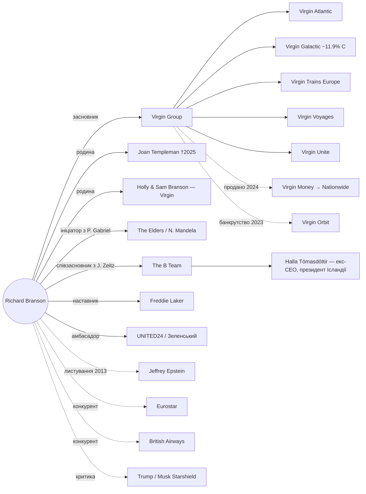

# Досьє: Sir Richard Branson — повний AI-OSINT цикл

> **Урок 11, воркшоп.** Інформаційний зріз: 03–04.11.2026. Аналітики: два незалежні AI-агенти — **Claude Opus 5.5** (основний збір) і **GPT-6 Astra** (паралельний збір). Дані GPT-6 Astra вибірково перевірено й злито у цей звіт.
> **Мета:** скласти due-diligence профіль публічної особи з відкритих джерел: кар'єра, платформи, психопрофіль, оцінка достовірності.
> **Етичні межі:** лише публічна роль і те, що суб'єкт сам оприлюднив. Адреси, контакти, дані онуків і приватних осіб не збиралися.
> **Додатки:** [досьє GPT-6 Astra](Richard_Branson_AI_OSINT_Dossier.md) · [журнал дослідження GPT-6 Astra](OSINT_Research_Log.md) · [CSV Instagram-вибірки](Instagram_Engagement_Sample.csv)

---

## 1. Суб'єкт

| Поле | Значення | Grade |
|---|---|---|
| Повне ім'я | Sir Richard Charles Nicholas Branson | A |
| Дата / місце народження | 18.07.1950, Blackheath, Лондон (вік 76) | A |
| Громадянство / резиденція | Британець. Публічно заявлене проживання — Necker Island, Британські Віргінські острови (BVI). З 2013 сам називає себе «tax exile». Юридичне резидентство не перевірялося | A / B (резидентство) |
| Поточна роль | **Засновник** Virgin Group (з 1970), а не CEO окремих компаній Virgin. LinkedIn headline: «Founder at Virgin Group» | A |
| Статус | Вдівець: дружина Joan Templeman (шлюб 1989, пара з 1976) померла 24.11.2025 | A |
| Діти (публічні) | Holly і Sam Branson, обидва мають керівні ролі у Virgin | B |
| Статок | ≈ $2.8 млрд (Forbes real-time, 02.11.2026; #1456 у світі). Пік ≈ $8 млрд (Bloomberg, 2021) | B |
| Титул | Knight Bachelor, березень 2000, «for services to entrepreneurship» | A |

**Хто це в одному абзаці.** Британський підприємець, засновник конгломерату Virgin: музика, авіація, телеком, фінанси, залізниця, круїзи, космос. Публічний бренд Virgin тримається на його особі: рекордні подорожі на повітряній кулі й катері, суборбітальний політ 11.07.2021. Він активний адвокат соціальних тем: Virgin Unite, The Elders, The B Team, клімат, скасування смертної кари, реформа політики щодо канабісу, підтримка України (амбасадор UNITED24 з 2023). Станом на 2026 рік основний публічний голос — LinkedIn: довгі пости з політичними позиціями, зокрема різка критика Трампа щодо Росії й України.

---

## 2. Методологія

**Інструменти.** У середовищі не було Perplexity, Exa, Tavily і Jina. Їх замінили:

| Агент | Пошук | Читання URL | Інше |
|---|---|---|---|
| Claude Opus 5.5 | `WebSearch` ×~17 | `WebFetch` ×~17, з них 7 невдалих (403/402/timeout) | `curl` + Python для TED `__NEXT_DATA__` |
| GPT-6 Astra | `web.run` (пакетний пошук) | Пряме відкриття + індексовані копії | Python (TED, CSV), Google Drive (0 результатів) |

Знання моделей використовувалися лише як **гіпотези** (Фаза 1.5). У звіт потрапило тільки те, що підтверджено зовнішнім джерелом. Обидва агенти не мають пошуку, незалежного від однієї пошукової системи. Тому збіг їхніх результатів — це підтвердження відтворюваності, а не два незалежні джерела.

**Фази.**

| Фаза | Що зроблено | Результат |
|---|---|---|
| 0. Брифінг | Вхід: ім'я + Wikipedia URL від викладача | Суб'єкт однозначний |
| 1. Первинний збір | Wikipedia, Forbes, CNN Fast Facts, Biography, новини 2025–26 | Базове біо + свіжі події |
| 1.5. Внутрішні джерела | Робоча папка: порожній README. Google Drive (Astra): 0 збігів. Первинні джерела суб'єкта: блог Virgin, Forbes, SEC 8-K | Внутрішніх матеріалів немає. Гіпотези моделей підтверджено на ~90% |
| 2. Платформи | LinkedIn (10 текстів), Instagram (12 постів, сторонній агрегатор), YouTube/TED (повний транскрипт), X, блог, Telegram | 4 платформи з контентом + 2 з ідентифікацією |
| 3. Перехресна перевірка | Кожен факт мінімум з 2 джерел; collision check; **перевірка даних другого агента** | Таблиця з 16 фактів, 8 суперечностей |
| 4. Психопрофіль | 3 довгі транскрипти: TED 2007, Tim Ferriss 2018, Adam Grant 2024 + 10 постів LinkedIn | MBTI з доказами і контраргументами |

**Як перевірено дані GPT-6 Astra:**

| Що перевірялося | Метод | Результат |
|---|---|---|
| Пости LinkedIn LI04, LI08 | Пряме відкриття URL | ✅ 2/2 справжні, автор «Founder at Virgin Group»; теми й відсутність emoji збігаються |
| TED-транскрипт: 110 абзаців / 535 сегментів / 4 978 слів / 29:29 | Повторне завантаження і парсинг `__NEXT_DATA__` | ✅ Точний збіг; цитати за мітками 01:18, 02:42, 15:01, 20:55, 22:35 відповідають опису |
| Instagram ER 0.1712% | Перерахунок CSV | ✅ Арифметика вірна. ⚠️ Сам Pikory повертає 403, дані не підтверджено → лишаються **C** |
| Решта джерел (SEC 8-K, B Team, Old Stoic PDF) | Не відкривалися повторно | Прийнято з оцінкою Astra; позначено `[A]` у таблиці |

> ⚠️ Частину посилань Astra дає через `com.prod.loyalty.virgin.com` — технічне дзеркало virgin.com (оригінал віддає 403). Зміст дзеркала тотожний, але сам домен не є канонічною адресою.

**Шкала достовірності** (узгоджена з Astra):
- **A**: ≥2 редакційно незалежні джерела або первинний документ + незалежне джерело.
- **B**: надійне первинне свідчення, але обмежена незалежність чи актуальність.
- **C**: одне джерело, непрямі або суперечливі дані.
- **D**: підстав недостатньо, як встановлений факт не включається.

Сторінки групи Virgin між собою, а також передруки одного агентства, незалежними не вважаються.

### Таблиця ідентифікаторів

| Платформа | Ідентифікатор | Аудиторія | Атрибуція |
|---|---|---|---|
| LinkedIn | `linkedin.com/in/rbranson` | ≈18.6 млн (2-й у світі після Bill Gates) | **A**: прямий гостьовий доступ, 3000+ постів, 123 статті |
| Instagram | `@richardbranson` | 4 989 165 (знімок Pikory, 10.2026) | **B**: handle у вбудованих постах Virgin; біо «Screw it, let's do it» = біо в X |
| X / Twitter | `@richardbranson` | ≈12.1 млн (2023: 12.6 млн) | **B**: verified, з 08.2007. Пряме читання — 403 |
| YouTube | Особистий `youtube.com/user/richardbranson`; аналізовано відео TED [`DudfBIxw6do`](https://www.youtube.com/watch?v=DudfBIxw6do) | н/д | **B** для TED-відео. Особистий канал до кінця не атрибутовано (rate limit) |
| Блог | `virgin.com/branson-family/richard-branson-blog` | — | **A**: офіційний домен |
| Telegram | **авторський канал не знайдено** | — | **D**: під його ім'ям лише сторонні й scam-канали («Fixed Matches», крипто). Відсутність у пошуку не доводить відсутності акаунта |

Сумарна аудиторія за даними Virgin: «41+ млн підписників».

---

## 3. Ключові знахідки

### 3.1 Кар'єрна хронологія (Grade A, якщо не зазначено інше)

| Рік | Подія |
|---|---|
| 1966–68 | Журнал *Student* (з Nik Powell), перший номер у січні 1968. Ранні дати суперечливі: **B** |
| 1966/67 | Покинув Stowe School. Сам Бренсон каже, що в 15 (TED 15:01), більшість довідок — у 16: **C** |
| 1970–73 | Поштовий продаж платівок → магазин → студія → лейбл Virgin Records. Рік лейблу: 1971 (CNN) / 1972 (Wikipedia) / 1973 (Virgin) |
| 1971 | Ніч в ув'язненні за ухилення від податків (purchase tax). Сума штрафу £70k: **C** |
| 1973 | *Tubular Bells* (Mike Oldfield), перший великий хіт лейблу |
| 1984 | Virgin Atlantic |
| 1992 | Продаж Virgin Records компанії Thorn EMI за £500 млн, щоб врятувати авіалінію від тиску BA («dirty tricks») |
| 1997 | Virgin Rail: франшизи CrossCountry і West Coast |
| 1999–2000 | Virgin Mobile; Virgin Blue (згодом Virgin Australia) |
| 2004 | Virgin Galactic; Virgin Unite (благодійне крило, **B**) |
| 2007 | Ініціатор The Elders разом з Peter Gabriel (засновано з Nelson Mandela). Членом The Elders не є |
| 2013 | Співзасновник The B Team з Jochen Zeitz (**B**) |
| 2020 | Пропонував Necker Island як заставу для порятунку Virgin Atlantic; 3000 скорочень |
| 11.07.2021 | Суборбітальний (не орбітальний) політ на VSS Unity, 86 км, у 70 років |
| 05.2023 | Банкрутство Virgin Orbit і продаж активів (SEC 8-K + Reuters). Заява, що більше не фінансуватиме Virgin Galactic |
| 10.2024 | Продаж Virgin Money UK компанії Nationwide (угода > $3.5 млрд; частка Branson ≈ £724 млн) |
| 08.2026 | ORR погодив до 20 щоденних рейсів Virgin Trains через тунель під Ла-Маншем з 01.10.2030 |
| 10.2026 | VTE замовила 12 потягів Alstom Avelia Stream. Virgin Galactic: Delta-корабель *Apeiron* здійснив перший captive-carry політ 28.10.2026 |

### 3.2 Перехресна перевірка ключових фактів

`[A]` — рядок узято з матриці GPT-6 Astra.

| # | Факт | Джерело 1 | Джерело 2 | Grade |
|---|---|---|---|---|
| 1 | Поточна роль: засновник Virgin Group | Wikipedia | LinkedIn headline / Forbes / CNN | **A** |
| 2 | Компанія: Virgin Group, без консолідованої звітності | Forbes | dontdiewondering.com (трасти на BVI) | **B** (оцінка, не аудит) |
| 3 | Локація: Necker Island, BVI | Wikipedia / Virgin | Forbes profile | **A** (публічна заява); **B** (юридичне резидентство) |
| 4 | Освіта: Scaitcliffe → Stowe, без ВНЗ, дислексія | Wikipedia; Old Stoic Society 2017 `[A]` | Biography `[A]`; TED 15:01 (самоопис) | **A** |
| 5 | Статок $2.8 млрд | Forbes (через WealthRank) | 3 інші трекери | **B** |
| 6 | Політ VSS Unity 11.07.2021 | Wikipedia | Reuters `[A]` | **A** |
| 7 | Банкрутство Virgin Orbit 2023 | SEC Form 8-K `[A]` | Reuters `[A]` / Forbes | **A** |
| 8 | Співзаснування The B Team з Jochen Zeitz | bteam.org `[A]` | Virgin Unite `[A]` | **B** (пов'язані джерела) |
| 9 | Смерть Joan 24.11.2025 | Блог «Remembering Joan» (першоджерело) | AP `[A]`, NBC, Fortune | **A** |
| 10 | Травма плеча (велосипед, Strive Challenge, Індія, 11.2025) | Блог Branson | IndiaWest | **A** |
| 11 | Листування з Epstein (2013) | CNN 03.02.2026 (DOJ files) | AP `[A]`, The Atlantic `[A]`, відповідь Virgin | **A** щодо факту листування. Оригінали листів не перевірено. Участі у злочинах цей факт не встановлює |
| 12 | Публічно критикує Трампа щодо Росії й України (LinkedIn, 10.2026) | Пост LI08 (перевірено напряму) | Irish Star | **B**. Конкретні цитати Irish Star про «appeasement»: **C** (paywall) |
| 13 | Заклик до реформи канабісу (04.2026) | Forbes (через пошук) | — | **C** |
| 14 | Стейк Virgin Group у Virgin Galactic 11.9% | Wikipedia | — (немає свіжого SEC-файлу) | **C** |
| 15 | Амбасадор UNITED24; візити до Києва 29.06.2022 і 10.04.2023 | u24.gov.ua | The Insider, Irish Examiner, Walk of the Brave | **A** |
| 16 | Кампанія BA «dirty tricks» проти Virgin Atlantic | TED 02:42 (самоопис) | Знання моделі | **B** |

**Підсумок:** 16 фактів: **A — 9, B — 5, C — 2** (суміжні підпункти з C в рядках 3, 11, 12 враховано за головним твердженням). Частка B+ — **87.5%**.

**Суперечності:**
1. **Вік виходу зі школи:** 15 (сам Бренсон, TED 2007; пост в X) проти 16 (Wikipedia, більшість довідок). Первинне свідчення суб'єкта суперечить вторинним → **C**.
2. **Рік лейблу Virgin Records:** 1971 (CNN) / 1972 (Wikipedia) / 1973 (хронологія Virgin). Ймовірно, різні події: магазин, студія, перший реліз. Хронологія Virgin також поєднує 1967 рік і вік 15 для *Student*, що не узгоджується з DOB.
3. **Підписники LinkedIn:** 18.64 млн (Substack, ~10.2026) проти 19.78 млн (знімок поста, дата невідома). Різні дати знімків.
4. **Перший комерційний рейс Delta:** лютий 2027 проти «early Q2 2027» (TradingView, ~10.2026). Новіше джерело вказує на Q2.
5. **Статок:** Bloomberg ~$8 млрд (2021) проти Forbes $2.1 млрд (2024) / $2.8 млрд (2026). Пояснюється SPAC-бумом і падінням SPCE.
6. **Virgin Money:** «£724 млн» (Wikipedia) проти «> $3.5 млрд» (Forbes). Обидва вірні: частка Branson і ціна угоди відповідно.
7. **Кліматична обіцянка $3 млрд (2006):** критики стверджують, що фактично внесено значно менше. Точної суми немає.
8. **Застаріле біо Virgin:** формулювання про спільне проживання з дружиною неактуальні після 11.2025 (знахідка Astra).

**Collision check (однофамільці й клони):** Richie Branson (репер, ім'я запозичене), «Branson Tannerites» (YouTube), `@RichardMBranson` (X, 733 підписники), `@richardbrason` / `@richardmbranson` / `@richard_branson1` (IG-клони), Telegram «Richard Branson – Fixed Matches» (беттінг-скам), місто Branson, Missouri (шум у новинах). Mediamass «Branson dead 2026» — шаблонний hoax. **Усі відфільтровані.**

### 3.3 Граф зв'язків



### 3.4 Платформна витяжка

**LinkedIn** — головний канал «голосу» у 2026. Вибірка GPT-6 Astra: 9 видимих постів + 1 стаття (жовтень 2026). Два пости перевірено напряму.

| Тема | Пости | Тон |
|---|---|---|
| Міжнародна політика (Трамп, Росія, Україна) | LI05, LI08 | Полемічний, емоційно-критичний |
| Лідерство / наставництво | LI03, LI09 | Афористичний, пояснювальний |
| Гуманітарне (землетрус у La Guaira, Венесуела) | LI04 | Співчутливий |
| Конкуренція (Heathrow) / бренд («Head of Yes») | LI01, LI07 | Критичний / промоційний |
| Наука, довкілля | LI06 | Закличний |
| Самоіронія (LI02; стаття 16.06.2026 про порвані штани під час трюку) | LI02, LI10 | Жартівливий, самокритичний |

Цитата LI08: *«Yesterday I thought that nobody could trump Trump's hypocrisy in demanding that people stop buying Russian oil… Yet only a day later, he has trumped himself»*. Те саме кількісно: 3 з 10 постів — політика й гуманітарне, 2 з 10 — бренд і конкуренція. Тобто LinkedIn для нього майданчик для громадянської позиції, а не корпоративних новин. Хронологію посад з гостьового профілю не відновити: кар'єра зібрана з інших джерел.

**Instagram** — особисте й родинне. Пости: смерть Joan (25.11.2025), святкування життя на Necker (31.12.2025, `instagram.com/p/DS7zNV0CNlh`), 81-й день народження Joan (06.07.2026), відео з меморіалу (~08.2026), літак Virgin Atlantic A330neo «Viva Forever» G-VLJB на честь Joan (30.09.2026). **Локації за підписами й пресою:** Necker Island, Kasbah Tamadot (Марокко), Індія (Taj Mahal, Strive Challenge). Нативних геотегів не отримано.

**Engagement rate** — 12 постів за 05–18.10.2026, дані агрегатора Pikory ([CSV](Instagram_Engagement_Sample.csv)), **Grade C**:

```
ER_mean   = Σ(likes + comments) / (n × followers) = 102 511 / (12 × 4 989 165) = 0.171%
ER_median = 4 215 / 4 989 165                                                 = 0.085%
```

- Розподіл дуже скошений: від 879 до 28 113 взаємодій на пост. Медіана вдвічі нижча за середнє, і як «типовий пост» вона чесніша.
- Коментарі — лише 4.7% взаємодій, тобто аудиторія пасивна.
- Медіана **0.085%** узгоджується з незалежною оцінкою ~0.09% (SPEAKRJ, ~2020). Отже ER стабільно низький: приблизно у 3–6 разів нижчий за бенчмарк брендів 0.48% (Socialinsider 2025), що типово для мегаакаунтів з 5 млн підписників.
- Обмеження: Pikory недоступний для повторної перевірки (403), немає охоплень і збережень.

**YouTube / TED** — *Life at 30,000 feet* (TED2007, бесіда з Chris Anderson). Повний транскрипт із даних сторінки TED: 4 978 слів, 29:29 (повторно відтворено). Ключові фрагменти:

| Мітка | Цитата Бренсона |
|---|---|
| 01:18 | «companies are all about finding the right people, inspiring those people… I'm incredibly inquisitive and I love taking on… the status quo» |
| 02:42 | «there's a very thin dividing line between success and failure» (далі про «dirty tricks» BA) |
| 15:01 | «I was dyslexic… one of the reasons I left school when I was 15 years old… if I'm not interested in something, I don't grasp it» |
| 20:55 | «if you treat people well, people will come back… all you have in life is your reputation» |
| 22:35 | «extreme wealth ends up in the hands of a few people, and therefore extreme responsibility… goes with that wealth» |

**X** — ~12.1 млн, аудиторія повільно падає (−0.5 млн з 2023). Пряме читання — 403. Доступні лише окремі пости: привітання Halla Tómasdóttir (08.2024) і вбудований допис про Hyperloop (11.2020).

**Telegram** — авторський канал не атрибутовано (**D**). Пункт чеклиста про аналіз 10+ постів невиконуваний. Scam-канали, що використовують його ім'я, — корисний індикатор ризику для аудиторії.

### 3.5 Психопрофіль

> Аналіз публічної поведінки й самопрезентації, **не** психологічне обстеження. Пости можуть редагуватися командою, інтерв'ю відбуваються в медійному контексті. Корпус: 3 довгі інтерв'ю з повними транскриптами (TED 2007, Tim Ferriss 2018, Adam Grant 18.06.2024), 10 текстів LinkedIn, пости Instagram через пресу.

**MBTI: гіпотеза ENFP (альтернатива — ENTP). Загальна впевненість: середня-низька.**

| Вісь | Оцінка | Доказ «за» | Доказ «проти» | Впевненість |
|---|---|---|---|---|
| **E** vs I | E (набута) | Публічні трюки й рекорди, 41 млн аудиторії, «most people want fun… want people to be human» (Grant) | «I was so shy when I was young…», «I think I've largely overcome it» (Grant). Публічність — частина професійної ролі | **середня** |
| S vs **N** | N | «I'm incredibly inquisitive… taking on the status quo» (TED 01:18); стрибки між галузями; «you're only gonna remember two or three things from that meeting»; не терпить PowerPoint | Пошук гострих відчуттів (кулі, кайтсерф) і конкретні споживчі проблеми — аргументи на користь S (ESTP) | **середня** |
| T vs **F** | F (слабко) | «companies are all about… inspiring those people» (TED); «if you treat people well…» (TED 20:55); «A company is just a group of people» (Grant); емоційні тексти про Joan; співчутливий LI04 | Жорстка конкуренція (BA, Eurostar, Heathrow LI01); «benevolent dictator» (Ferriss); продаж Virgin Records заради авіалінії | **низька** |
| J vs **P** | P | «I'm known as Dr. Yes… screw it, let's do it» (Grant); «saying yes now and figuring it out later»; «if I'm not interested in something, I don't grasp it» (TED 15:01) | «protect the downside», «think of all the things that could potentially go wrong» (Ferriss); у статті LI10 після провалу трюку вирішив надалі залучати фахівця | **середня** |

**Розбіжність між агентами.** GPT-6 Astra свідомо **не присвоїла** чотирилітерний тип: усі осі в неї низької впевненості, корпус — 1 відео 2007 року + радіо 2014 року. Їхній аргумент коректний: редагована публічна персона не дає надійної типізації. У Claude корпус більший (+2 довгі розмови, зокрема свіжа 2024 року, де Бренсон рефлексує про себе). Тому тип ENFP подано як **робочу гіпотезу**. Найслабша вісь — T/F, найсильніша — P.

**Big Five (якісно):** Openness ↑↑, Extraversion ↑ (поведінкова), Agreeableness ↑ (публічна персона), Conscientiousness ↓ (компенсується делегуванням: дислексія «taught me to delegate»), Neuroticism ↓ («pick yourself up, shake yourself down, and try again»; «once the competition is over, I really do not mind whether I've won or lost»).

**Стиль комунікації:**
- **Довжина речень:** у мовленні середня (~15 слів): довгі ланцюжки через «and… so…» чергуються з афоризмами («The brave may not live forever, but the cautious do not live at all»). У LinkedIn короткі афористичні речення поєднуються з розгорнутими історіями й риторичними запитаннями.
- **Вербальні маркери:** «you know», «I think», «I mean», «lovely», «extraordinary», «fun». Часті самовиправлення й самоіронія.
- **Emoji-щільність:** **низька**. У LinkedIn 1 з 10 текстів містить emoji (10%, дані Astra; у перевіреному LI08 — 0). В Instagram не виміряно.
- **Формальний vs неформальний:** LinkedIn — полемічні й закличні тексти з політичною позицією, формальніші. Instagram — інтимний, родинний тон. Блог — розповідь від першої особи («As many already know, I'd come off my bike in India…»). Порівняння LinkedIn↔Telegram неможливе, тому замінено порівнянням LinkedIn↔Instagram.

**Цінності (за діями, а не словами):**
1. **Ризик і пригоди, але з навчанням**: рекорди 1986–2014, космос у 70, велогонки в 75 попри травми 2016, 2021 і 2025. Водночас провал Virgin Orbit і урок зі статті LI10 показують, що сміливість ≠ ефективність.
2. **Родина**: літак, названий на честь Joan; публічна жалоба; діти на керівних посадах.
3. **Права людини й глобальне врядування**: Virgin Unite, The Elders, B Team, кампанія проти смертної кари, Україна (2 візити під час війни + регулярні LinkedIn-пости), Венесуела (LI04).
4. **Конкуренція з монополіями**: BA (1980–90-ті, «dirty tricks» за TED 02:42), Eurostar («end this 30-year monopoly»), Heathrow (LI01).
5. **«Відповідальність багатства»** як декларація (TED 22:35). Розбіжності з діями: статус «tax exile» поруч із проханням про держдопомогу 2020; неповністю виконана кліматична обіцянка; листування з Epstein 2013 — репутаційний ризик для ESG-персони.

---

## 4. Прогалини

| Прогалина | Причина | Як закрити |
|---|---|---|
| Нативний engagement rate Instagram | Є лише агрегатор Pikory (C), сам Pikory повертає 403; немає охоплень і збережень | Instagram Graph API / HypeAuditor; фіксований зріз 12+ постів з постійними URL |
| Точні дати постів LinkedIn | Гостьовий перегляд показує лише `1d`/`3w`, і в різних знімках вони різні | Декодувати час з activity-ID (перші 41 біт — Unix ms) |
| Оригінал поста LinkedIn про «appeasement» (10.2026) | Irish Star за paywall (402); у вибірці Astra інший пост на ту саму тему | Пряма стрічка LinkedIn з сесією |
| Особистий YouTube-канал і свіжий відеокорпус | Rate limit / JS-рендеринг; аналізоване відео — 2007 року | `yt-dlp --write-auto-subs` для 2–3 відео 2025–26 |
| Повна стрічка X | 403 для анонімного доступу | Браузер з сесією / платний API |
| Авторський Telegram | Канал не атрибутовано | Не закривається пошуком. Підтвердити можна лише посиланням з офіційного сайту |
| Поточна структура володіння Virgin Group і стейк у Galactic | Немає консолідованої звітності; трасти на BVI | SEC 13D/13G для SPCE; Companies House |
| Ранні дати (школа, *Student*, лейбл) | Суперечливі спогади й довідки | Архів Stowe, датовані перші випуски *Student* |
| Повний репутаційний аудит | Оригінали листів Epstein, судові справи, виконання кліматичної обіцянки не перевірено | DOJ-архів, судові реєстри, звітність Virgin Unite |

---

## 5. Depth Score і метрики

### **Depth Score: 8 / 10 — «Due diligence»**

| Критерій шкали | Статус |
|---|---|
| Повна кар'єра | ✅ 1966–2026 |
| 3+ платформи (5+ для 9–10) | ✅ 4 з контентом (LinkedIn, Instagram, YouTube/TED, блог) + X і Telegram на рівні ідентифікації |
| DOB підтверджено | ✅ A (CNN + Biography + Wikipedia; вік у Forbes збігається) |
| Більшість фактів Grade B+ | ✅ 14 з 16 (87.5%) |
| Психопрофіль | ⚠️ Середньо-низька впевненість: 3 транскрипти + 10 постів, але персона редагована, і агенти розійшлися щодо присвоєння типу |
| Сім'я / хобі | ✅ Публічні члени родини, кайтсерф, велоспорт (Strive Challenge), повітроплавання |

**Розбіжність з GPT-6 Astra (7/10).** Astra оцінювала лише власний корпус. У ньому немає подій 2025–26 (Virgin Trains, Apeiron, Україна, родинні пости в Instagram), лише 1 відео та 12 постів з неперевіреного агрегатора. Злиття двох корпусів закриває кар'єру до 2026 і дає прямий текст LinkedIn та повний TED-транскрипт. Цього достатньо для впевнених 8.

**Чому не 9:** психопрофіль не високої впевненості; Instagram-метрики Grade C; немає нативного доступу до X та Instagram.

### Метрики й витрати

| Метрика | Значення |
|---|---|
| Пошукові запити | Claude ~17 + Astra ~14 репрезентативних |
| Читання URL | Claude ~17 (7 невдалих); Astra — 29 URL у реєстрі (статуси в [журналі](OSINT_Research_Log.md)) |
| Опрацьований контент | 10 текстів LinkedIn, 12 записів Instagram, 1 повний відеотранскрипт (4 978 слів), 2 повні подкаст-транскрипти, фрагменти радіо (Diane Rehm 2014) |
| Платформи | 4 з контентом + 2 з ідентифікацією |
| Фактів у матриці | 16 (A: 9, B: 5, C: 2, D: 0) |
| Перевірка даних другого агента | 4 точки, усі збіглися. 1 джерело недоступне (Pikory) |
| Фінансові витрати | Платних звітів і підписок не було. Вартість інференсу моделей і пошуку середовище не надає, тому вона **невідома** (а не «$0») |
| Час | Claude ~35 хв (збір + злиття). Astra — 12 хв 4 с між контрольними мітками (03.11.2026 21:51–22:03 UTC) |

---

## Джерела

- Wikipedia — [Richard Branson](https://en.wikipedia.org/wiki/Richard_Branson), [Virgin Galactic](https://en.wikipedia.org/wiki/Virgin_Galactic), [Virgin Trains (open-access)](https://en.wikipedia.org/wiki/Virgin_Trains_(open-access_operator)), [Walk of the Brave](https://en.wikipedia.org/wiki/Walk_of_the_Brave)
- Біографії — [CNN Fast Facts (KESQ, 29.06.2026)](https://kesq.com/news/national-world/cnn-world/2026/06/29/richard-branson-fast-facts-6/), [Biography](https://www.biography.com/business-leaders/richard-branson), [Forbes profile](https://www.forbes.com/profile/richard-branson/), [WealthRank (Forbes RT)](https://www.wealthrank.in/person/richard-branson-1426), [Old Stoic Society 2017](https://www.stowe.co.uk/getmedia/c06cc64b-b287-444f-a11c-d5554eb6c2eb/Old-Stoic-Society-Accounts-2017-FINAL)
- Virgin — [Хронологія](https://com.prod.loyalty.virgin.com/about-virgin/timeline) (дзеркало), [Virgin Atlantic: our story](https://www.virginatlantic.com/corporate/our-story), [Virgin Unite](https://unite.virgin.com/about-us/index.html?region=ph), [The B Team: history](https://www.bteam.org/who-we-are/our-history), [Remembering Joan](https://www.virgin.com/branson-family/richard-branson-blog/remembering-joan), [Visiting Ukraine](https://www.virgin.com/branson-family/richard-branson-blog/visiting-ukraine), [All abroad! (Channel Tunnel)](https://www.virgin.com/branson-family/richard-branson-blog/all-abroad-virgin-is-on-track-to-launch-a-rival-train-service-through-the)
- Первинні документи — [SEC Form 8-K, Virgin Orbit (05.2023)](https://www.sec.gov/Archives/edgar/data/1843388/000162828023020105/vorb-20230523.htm)
- Транскрипти — [TED: Life at 30,000 feet](https://www.ted.com/talks/richard_branson_life_at_30_000_feet/transcript) / [YouTube](https://www.youtube.com/watch?v=DudfBIxw6do), [ReThinking with Adam Grant (2024)](https://www.ted.com/podcasts/www.ted.com/podcasts/richard-branson-on-saying-yes-now-and-figuring-it-out-later-transcript), [Tim Ferriss Show #272 (2018)](https://tim.blog/2018/02/02/the-tim-ferriss-show-transcripts-sir-richard-branson/), [Diane Rehm (2014)](https://dianerehm.org/shows/2014-09-23/richard-branson-virgin-way/)
- LinkedIn — [профіль](https://www.linkedin.com/in/rbranson), [LI08 Trump/Russian oil](https://www.linkedin.com/posts/rbranson_yesterday-i-thought-that-nobody-could-trump-activity-7515451258703372288-VD5L), [LI04 La Guaira](https://www.linkedin.com/posts/rbranson_nothing-could-prepare-me-for-my-visit-to-activity-7519055343134408704-JF7x), [LI09 Mentorship](https://www.linkedin.com/posts/rbranson_my-number-one-piece-of-advice-for-anyone-activity-7515394941322457088-CgDj), [LI10 стаття](https://www.linkedin.com/pulse/time-i-ripped-my-trousers-jumping-off-tallest-building-branson-pwz1c); решта — у [журналі Astra](OSINT_Research_Log.md). [Substack: 100 most-followed](https://melaniegoodmanlinkedinconsultant.substack.com/p/100-most-followed-linkedin-profiles-data-analysis), [OutX 2026](https://www.outx.ai/blog/most-followed-person-linkedin)
- Інші платформи — [Instagram](https://www.instagram.com/richardbranson/), [Pikory](https://pikory.com/u/richardbranson/215712317), [X](https://x.com/richardbranson), [YouTube](https://www.youtube.com/user/richardbranson), [SPEAKRJ IG](https://www.speakrj.com/audit/report/richardbranson/instagram), [SPEAKRJ X](https://www.speakrj.com/audit/report/richardbranson/twitter), [Socialinsider 2026](https://www.socialinsider.io/social-media-benchmarks/instagram)
- Новини — [CNN: Epstein files](https://www.cnn.com/2026/02/03/politics/epstein-files-musk-lutnick-branson-emails), [AP: Epstein](https://apnews.com/article/682447e50bf9a3643a36c9b54ccdfa22), [The Atlantic](https://www.theatlantic.com/ideas/2026/04/epstein-files-contacts-degrees/686265/), [Irish Star](https://www.irishstar.com/news/us-news/billionaire-richard-branson-writes-lengthy-37782954), [AP: Joan](https://apnews.com/article/9faac6930d67293967b46d1027b91c96), [NBC](https://www.nbcnews.com/news/obituaries/joan-branson-wife-british-billionaire-richard-branson-dies-80-rcna246023), [IndiaWest](https://indiawest.com/an-accident-in-india-brought-richard-branson-close-to-wife-in-her-final-hours/), [Hello!](https://www.hellomagazine.com/us/920254/richard-branson-shares-emotional-glimpse-into-late-wife-joan-celebration-of-life/), [Migflug](https://migflug.com/afterburner/viva-forever-virgin-atlantic-a330neo-joan-branson-2026/), [Reuters/Investing: spaceflight](https://www.investing.com/news/world-news/billionaire-branson-soars-to-space-aboard-virgin-galactic-flight-2554769), [Reuters/Yahoo: Virgin Orbit](https://finance.yahoo.com/news/1-virgin-orbit-sell-manufacturing-183601788.html), [UPI: ORR](https://www.upi.com/Top_News/World-News/2026/08/17/Virgin-trains-approved-for-Cross-channel-services/7031786967829/), [newmobility.news](https://newmobility.news/en/2026/08/19/virgin-trains-gets-green-light-for-20-daily-channel-tunnel-services/), [collectSPACE: Apeiron](http://www.collectspace.com/news/news-102826a-virgin-galactic-delta-class-spaceship-apeiron.html), [TradingView](https://www.tradingview.com/news/stocktwits:532d5695a094b:0-spce-stock-slips-after-hours-as-branson-s-virgin-galactic-delays-first-delta-flight-to-early-q2-2027/), [CNN Money: dyslexia](https://money.cnn.com/2015/05/08/investing/richard-branson-dyslexia/)
- Україна — [UNITED24](https://u24.gov.ua/news/richard_branson_ambassador), [The Insider (2022)](https://theins.press/en/news/252717), [Irish Examiner (2023)](https://www.irishexaminer.com/world/arid-40907165.html)
