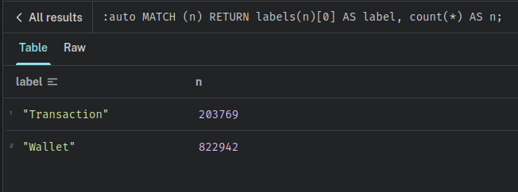
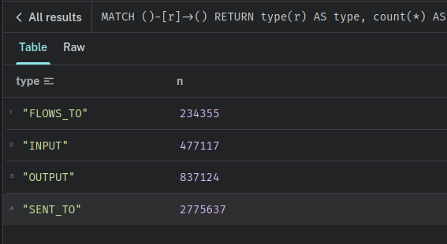
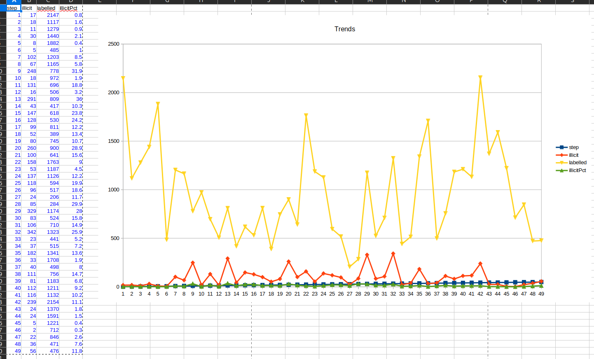
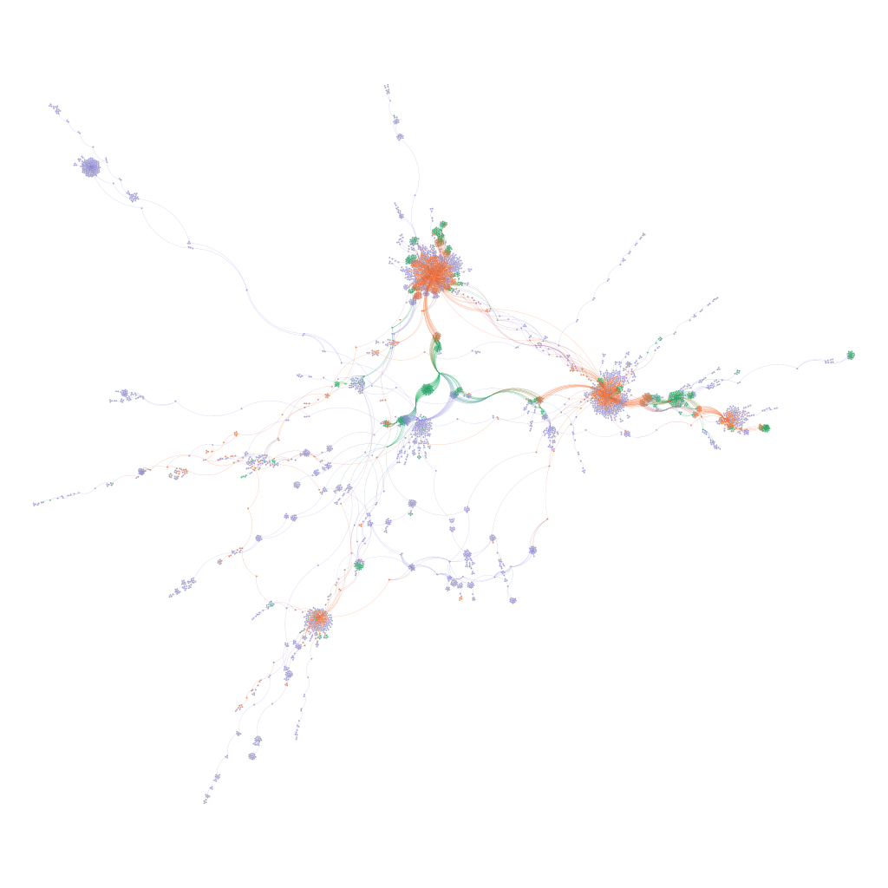

## Локальна база Neo4j

Каталог `data/` містить локальні файли Neo4j і не зберігається в Git.
Після клонування база буде порожньою: для відтворення результатів потрібно
окремо імпортувати дані або відновити резервну копію.

Перед запуском Docker Compose встановіть змінну середовища `NEO4J_AUTH` у
форматі `neo4j/<пароль>`:

```sh
export NEO4J_AUTH='neo4j/<ваш-пароль>'
docker compose up -d
```

Для наявної бази використовуйте її поточні облікові дані. Не додавайте пароль
до репозиторію.

Імпорт:






## 1. Trends:

```sql
MATCH (t:Transaction) WHERE t.class IN [1, 2]
WITH t.timeStep AS step,
     count(CASE WHEN t.class = 1 THEN 1 END) AS illicit,
     count(*) AS labelled
RETURN step, illicit, labelled,
       round(100.0 * illicit / labelled, 1) AS illicitPct
ORDER BY step;
```


| step | illicit | labelled | illicitPct |
|---:|---:|---:|---:|
| 1 | 17 | 2147 | 0.8 |
| 2 | 18 | 1117 | 1.6 |
| 3 | 11 | 1279 | 0.9 |
| 4 | 30 | 1440 | 2.1 |
| 5 | 8 | 1882 | 0.4 |
| 6 | 5 | 485 | 1 |
| 7 | 102 | 1203 | 8.5 |
| 8 | 67 | 1165 | 5.8 |
| 9 | 248 | 778 | 31.9 |
| 10 | 18 | 972 | 1.9 |
| 11 | 131 | 696 | 18.8 |
| 12 | 16 | 506 | 3.2 |
| 13 | 291 | 809 | 36 |
| 14 | 43 | 417 | 10.3 |
| 15 | 147 | 618 | 23.8 |
| 16 | 128 | 530 | 24.2 |
| 17 | 99 | 811 | 12.2 |
| 18 | 52 | 389 | 13.4 |
| 19 | 80 | 745 | 10.7 |
| 20 | 260 | 900 | 28.9 |
| 21 | 100 | 641 | 15.6 |
| 22 | 158 | 1763 | 9 |
| 23 | 53 | 1187 | 4.5 |
| 24 | 137 | 1126 | 12.2 |
| 25 | 118 | 594 | 19.9 |
| 26 | 96 | 517 | 18.6 |
| 27 | 24 | 206 | 11.7 |
| 28 | 85 | 284 | 29.9 |
| 29 | 329 | 1174 | 28 |
| 30 | 83 | 524 | 15.8 |
| 31 | 106 | 710 | 14.9 |
| 32 | 342 | 1323 | 25.9 |
| 33 | 23 | 441 | 5.2 |
| 34 | 37 | 515 | 7.2 |
| 35 | 182 | 1341 | 13.6 |
| 36 | 33 | 1708 | 1.9 |
| 37 | 40 | 498 | 8 |
| 38 | 111 | 756 | 14.7 |
| 39 | 81 | 1183 | 6.8 |
| 40 | 112 | 1211 | 9.2 |
| 41 | 116 | 1132 | 10.2 |
| 42 | 239 | 2154 | 11.1 |
| 43 | 24 | 1370 | 1.8 |
| 44 | 24 | 1591 | 1.5 |
| 45 | 5 | 1221 | 0.4 |
| 46 | 2 | 712 | 0.3 |
| 47 | 22 | 846 | 2.6 |
| 48 | 36 | 471 | 7.6 |
| 49 | 56 | 476 | 11.8 |

| Група | illicit | labelled | Частка |
|---:|---:|---:|---:|
| Кроки 1–42 | 4376 | 39877 | 10.97% |
| Кроки 43–49 | 169 | 6687 | 2.53% |


Зважена частка (pooled proportion):

$$\text{Частка}_{group} = \frac{\sum_{i \in group} \text{illicit}_i}{\sum_{i \in group} \text{labelled}_i} \times 100\%$$

Тобто для кроків 1–42:

$$\frac{17 + 18 + 11 + \dots + 239}{2147 + 1117 + 1279 + \dots + 2154} \times 100 = \frac{4376}{39877} \times 100 = 10.97\%$$

Для кроків 43–49:

$$\frac{24 + 24 + 5 + 2 + 22 + 36 + 56}{1370 + 1591 + 1221 + 712 + 846 + 471 + 476} \times 100 = \frac{169}{6687} \times 100 = 2.53\%$$





**Висновок:**

Це часовий зріз Bitcoin-транзакцій (з інтервалом ~2 тижні), а частка illicit показує долю протиправних серед розмічених транзакцій за період. На кроках 1–42 вона становить 10.97%, а на 43–49 падає до 2.53% — майже вчетверо, через відоме раптове закриття великого даркнет-майданчика приблизно на 43-му кроці. Це означає, що базовий рівень протиправної активності нестабільний у часі й стрибкоподібно змінюється після реальних подій. Тому модель, навчену на «до-подієвих» кроках, не можна наївно тестувати на пізніших — часовий concept drift різко знижує її якість.


## 2. Патерни.

2.1. Fan-In

```sql
MATCH (w:Wallet)
WITH COUNT { (w)<-[:SENT_TO]-() } AS senders
RETURN percentileDisc(senders, 0.99) AS p99,
       percentileDisc(senders, 0.999) AS p999,
       max(senders) AS max;

// Крок 1 — поріг fan-in на рівні 99.9-го перцентиля
MATCH (w:Wallet)
WITH COUNT { (w)<-[:SENT_TO]-() } AS senders
WITH percentileDisc(senders, 0.999) AS p999

// Крок 2 — гаманці з fan-in вище порога, розбивка за класом
MATCH (w:Wallet)
WITH p999, w, COUNT { (w)<-[:SENT_TO]-() } AS fanIn
WHERE fanIn > p999
RETURN w.class AS class,
       count(*)   AS wallets,
       min(fanIn) AS minFanIn,
       max(fanIn) AS maxFanIn
ORDER BY wallets DESC;

```


| p99 | p999 | max |
|---:|---:|---:|
| 46 | 103 | 11213 |

| class | wallets | minFanIn | maxFanIn |
|---:|---:|---:|---:|
| 2 | 416 | 104 | 11213 |
| 3 | 342 | 104 | 5019 |
| 1 | 21 | 104 | 1996 |

Хвіст високого fan-in (>103) майже повністю складається з легітимних (class 2 — 416) та нерозмічених (class 3 — 342) гаманців, тоді як illicit (class 1) — лише 21 із 779, тобто ~2.7%. Отже сам по собі високий fan-in — слабка ознака протиправності: він переважно ловить легітимні консолідаційні хаби (біржі, процесори), тому його варто використовувати лише в комбінації з іншими фічами, а не як самостійний поріг для підозри.

2.2. Peel chain

```sql
MATCH p = (s:Transaction {class: 1})-[:FLOWS_TO*5]->(:Transaction)
WHERE all(t IN nodes(p) WHERE t.nOut = 2 AND t.outMin < 0.1 * t.outMax)
RETURN count(DISTINCT s) AS starts;

MATCH p = (s:Transaction {class: 1})-[:FLOWS_TO*5]->(:Transaction)
WHERE all(t IN nodes(p) WHERE t.nOut = 2 AND t.outMin < 0.05 * t.outMax)
RETURN count(DISTINCT s) AS starts;
```

| starts |
|---:|
| 366 |

| starts |
|---:|
| 357 |

Кількість стартів зменшилася лише з 366 до 357 (−9, ≈2.5%), тобто вимога тримати peeling-патерн (2 виходи, розкол ≈90/10) на всіх 5 хопах майже нічого не відсіює. Це означає, що ланцюжки довгі, лінійні й однорідні — класична сигнатура layering, де на кожному кроці відшаровується тонкий клаптик, а основна маса йде далі.

2.3. Експозиція

```sql
MATCH (i:Wallet {class: 1})-[:SENT_TO*1..2]->(u:Wallet {class: 3})
WITH u, count(DISTINCT i) AS exposure
RETURN u.address AS address, exposure
ORDER BY exposure DESC LIMIT 3;
```
| address | exposure |
|---|---:|
| 18sJPXgoWoL3Z1pcM22QvWwyyFVhwxrXE9 | 1061 |
| 1781T3nnX2ncqTHYbRcac1R58VR1mFvmqt | 1061 |
| 3BBio7imFnNJ2cJEMoArJ1QcBzS4NmvAfr | 319 |

MATCH (x:Wallet)-[:SENT_TO]->(:Wallet {address: "18sJPXgoWoL3Z1pcM22QvWwyyFVhwxrXE9"}) RETURN x.address, x.class;

| x.address | x.class |
|---|---:|
| "1FvtWwP3ePJDeR6K7ZePGujUuusUTds8Vy" | 1 |

MATCH (x:Wallet)-[:SENT_TO]->(:Wallet {address: "1781T3nnX2ncqTHYbRcac1R58VR1mFvmqt"}) RETURN x.address, x.class;

| x.address | x.class |
|---|---:|
| "1FvtWwP3ePJDeR6K7ZePGujUuusUTds8Vy" | 1 |

MATCH (x:Wallet)-[:SENT_TO]->(:Wallet {address: "3BBio7imFnNJ2cJEMoArJ1QcBzS4NmvAfr"}) RETURN x.address, x.class;

| x.address | x.class |
|---|---:|
| 3Qg9bLf1KJGGduKsoBGCTTDkx62yGvFJSz | 3 |
| 3MnQyozUuWa9MseywsiYVHW9kj9eoE9AMT | 1 |
| 3MqRDKdYz3TtjRQCyFENgWt2bujFam1PVA | 3 |
| 3MUS5KQUF8UZ1R1ScgMDg64ujiLuTAuKRU | 3 |
| 3L9qocZTsfz8vc5K69F7Qe6QzK3UZkVFkW | 3 |
| 3JkQbJ8ogZFLLsgM35ixnxomLMCctH976t | 3 |
| 3JM4eFkJuvoN1roNcPopX7rb44D34tEp5Q | 3 |
| 3J8EwYDvSXpi5Xc71v4iw5GYq5j3ZpARf7 | 3 |
| 3HRKczobMnm8zCCJrQ1uDKeYvWWpDQyix7 | 3 |
| 3GMF797YJcnBhYvW6NfzwZKUzJAd5BEro6 | 3 |
| 3GfjPxWLxBE9Bp2hFjbmG7d913PHDUDov3 | 3 |
| 3EZmxBMzACr2Z498evCHfF1B4rpvnHL2ro | 3 |
| 3Ct8eepvosHKcJgbm5RqaExLRF6SreRmDW | 3 |
| 3CYygN4MerkPsYnoRG2ntgtawpriVctUHJ | 3 |
| 3CZS72hf3rLLN7HNZByAaQ4u6yPBc3uQZ1 | 3 |
| 3CFLm6MYXgFSScViTuYAZCyQ1rtbPVeZgJ | 3 |
| 3BXrndNtv7YXVqLu6w9BsDQsHdhmbJyCHD | 3 |
| 3BF66GMGU3AbWsPyonCYQhreR2QF7UNPDk | 3 |
| 3BZL5deGrQvr6KPuHu16JPeoyQp3sAuR4F | 3 |
| 3BM1fnBUDKy2vF25w1EdNAhKGuwQ64Rh6S | 3 |
| 3Ac7VesqEVBwvcJGQ4Y9RA78VbZax3qE4E | 3 |
| 39RhXFyFYrixLRdD6VLV5FeBp3ZXSaT2pd | 3 |
| 39yiZEmfWNM3wWPgbPVYC9ujTh9dM43FJS | 3 |
| 37ZCuwBeWt69qv6tG4HUmQWRnKcnPw2A63 | 3 |
| 36fCew1d2P2tgMorMekDSsVcFKcqd3zAd2 | 3 |
| 36k9HrjqED7aKnj54aczmStJqGeQxqcSk9 | 3 |
| 35wQHD2v9YNw7RUVuHwRzU53hGmmQnSxt5 | 3 |
| 35vWo7y884SB9rBXvrR1BnQEUnRoCtEoaZ | 3 |
| 34hTjT3cvdoFytHZ3BFoAgGpme9uQdGhjc | 3 |
| 346PhiyUvjjDEnkvTpeGNj5ZFEEYvPhwgP | 3 |
| 33h4bnBpEtNw76kD9KPBcHRZQmQ94ybYLh | 3 |
| 31hTi3vGu12yNqjQm3Yc29cBimuizvGJPg | 3 |
| 31x1BXLUXKCk9XSnZQzJLxgXCqJrL3d4xf | 3 |

Слабкий. Коли висока експозиція сходиться через одного прямого відправника (як у двох перших адрес — єдиний сендер 1Fvt…, class 1), великий лік «distinct illicit» — це артефакт 2-хопового fan-in через одне «пляшкове горлечко», а не широкий незалежний контакт із багатьма illicit-джерелами: по суті ви перераховуєте експозицію однієї вищерозташованої транзакції. Сильним сигнал стає лише за різноманіття прямих illicit-відправників (як у третьої адреси з великим списком сендерів), тож метрику варто дедуплікувати за прямим відправником або зважувати на кількість незалежних шляхів, інакше single-sender bottleneck даватиме хибно високу підозрілість.


## 3. Спільноти

```sql
MATCH (w:Wallet)
WITH count(*) AS total, count(CASE WHEN w.class = 1 THEN 1 END) AS totalIllicit
MATCH (w:Wallet)
WITH 1.0 * totalIllicit / total AS base, w.louvain AS community, count(*) AS size,
     count(CASE WHEN w.class = 1 THEN 1 END) AS illicit
WHERE size >= 20
RETURN community, size, illicit,
       round(100.0 * illicit / size, 1) AS illicitPct,
       round(illicit / (size * base), 1) AS lift
ORDER BY illicitPct DESC LIMIT 5;
```

| community | size | illicit | illicitPct | lift |
|---:|---:|---:|---:|---:|
| 686541 | 78 | 33 | 42.3 | 24.4 |
| 732745 | 5318 | 1142 | 21.5 | 12.4 |
| 207496 | 2738 | 569 | 20.8 | 12.0 |
| 622653 | 2830 | 537 | 19.0 | 10.9 |
| 718392 | 5122 | 919 | 17.9 | 10.4 |

```sql
MATCH (u:Wallet {louvain: 686541, class: 3})   // 123 → номер вашої спільноти
RETURN u.address AS lead, round(u.pagerank, 2) AS pagerank, u.inDeg AS senders
ORDER BY pagerank DESC LIMIT 3;
```

| lead | pagerank | senders |
|---|---:|---:|
| 1PMBzVZqD7uqsDr8LQKXFyXb7eggRUUfP9 | 3.83 | 1.0 |
| 19L3MtGJ16GXBF8gJmsLYz76KTjPPm6Jnk | 0.71 | 1.0 |
| 17t2NY43e8ziZa2Ra8NbNfimij3sYuLMiv | 0.48 | 1.0 |


## 4. Gephi



Колір вузла кодує клас (помаранчевий — illicit/class 1, зелений — licit/class 2, фіолетовий — unknown/class 3), а розмір вузлів у цьому експорті однаковий — тож яскраві «зірчасті» згустки є не великими вузлами, а щільними скупченнями багатьох дрібних вузлів, стягнених силовою розкладкою (ребра успадковують колір відправника).

Illicit-гаманці не утворюють окремого острова — вони вплетені в ті самі центральні хаби разом із licit/unknown (illicit складають ≈28% вузлів), але всередині цих хабів помітно злипаються локально: серед 10 найближчих сусідів illicit-вузла в середньому ~69% теж illicit, тобто приблизно у 2.5 раза щільніше за базові 28%.

## 5. Висновки

**Лід.** Адреса 3BBio7imFnNJ2cJEMoArJ1QcBzS4NmvAfr (unknown, class 3). Обрана тому, що з трьох топ-адрес за illicit-експозицією лише вона має багато прямих відправників: у двох інших висока експозиція сходилася через один гаманець (1Fvt…) — артефакт 2-хопового fan-in. Тут сигнал не «надутий» пляшковим горлечком.

**Два незалежні сигнали.** (1) Експозиція: до адреси за 1–2 кроки надходили кошти від великої кількості різних illicit-гаманців, причому й прямі відправники різноманітні. (2) Структурна позиція у графі: вузол лежить в illicit-збагаченому околі головного хабу (локальна гомофілія illicit ≈2.5× понад базові 28%). Сигнали незалежні: перший — це напрямлений вхідний лік illicit-джерел, другий — ненапрямлена топологія сусідства з повної розкладки; висока експозиція не випливає автоматично з того, що вузол сидить у щільному скупченні, і навпаки.

**Альтернативне пояснення.** Адреса починається з «3» (P2SH) — типово для бірж, мультипідпису чи платіжних сервісів. Високий fan-in від багатьох відправників, частина яких illicit, — це рівно те, як виглядає депозитна адреса біржі або міксер/CoinJoin, а не обов'язково колектор відмивання. Не виключена й помилка розмітки вхідних гаманців.

**Рівень упевненості:** помірний. Диверсифікована експозиція відкидає слабкий single-sender артефакт, що дискредитував перші два ліди, тож це вже не шум. Але P2SH + високий fan-in однаково сумісні з легітимним сервісом, а сам датасет не розрізняє депозитний хаб і колектор — тому не «високий».

**Наступний крок.** Перевірити адресу поза датасетом: block explorer (mempool.space, blockchair) — число транзакцій, баланс, контрагентів; відкриті атрибуції (WalletExplorer-кластеризація, Arkham, OFAC SDN-список, BitcoinAbuse). Тег «біржа/сервіс» знизить підозру; невідома адреса зі стійким illicit-притоком — підстава ескалювати.