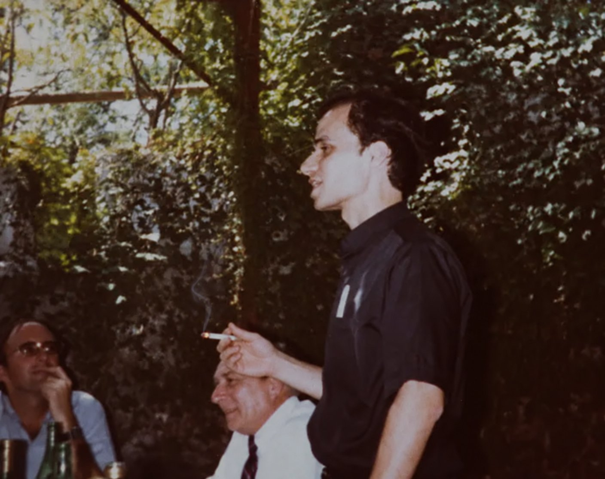
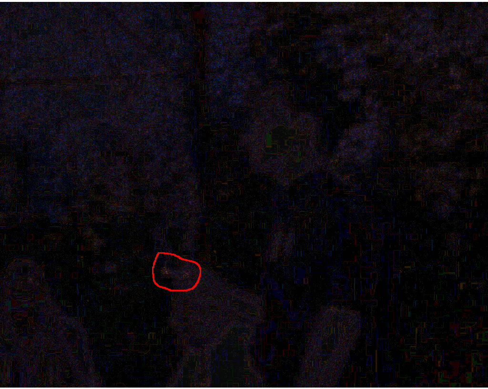
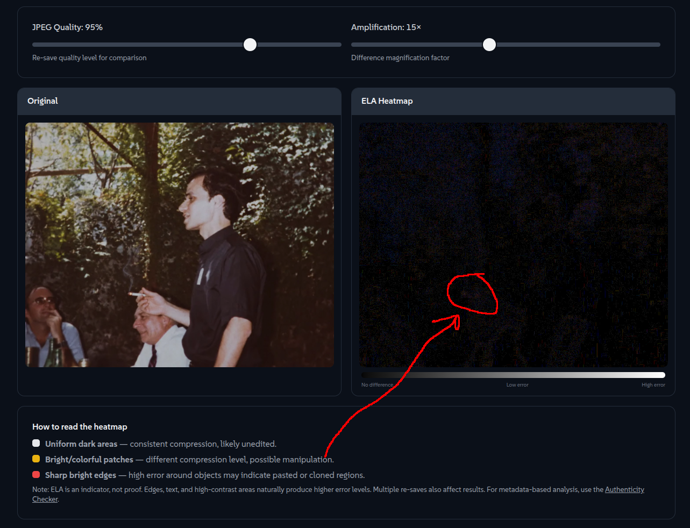
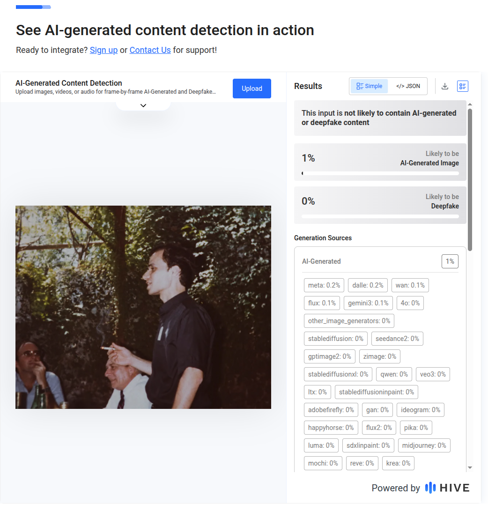
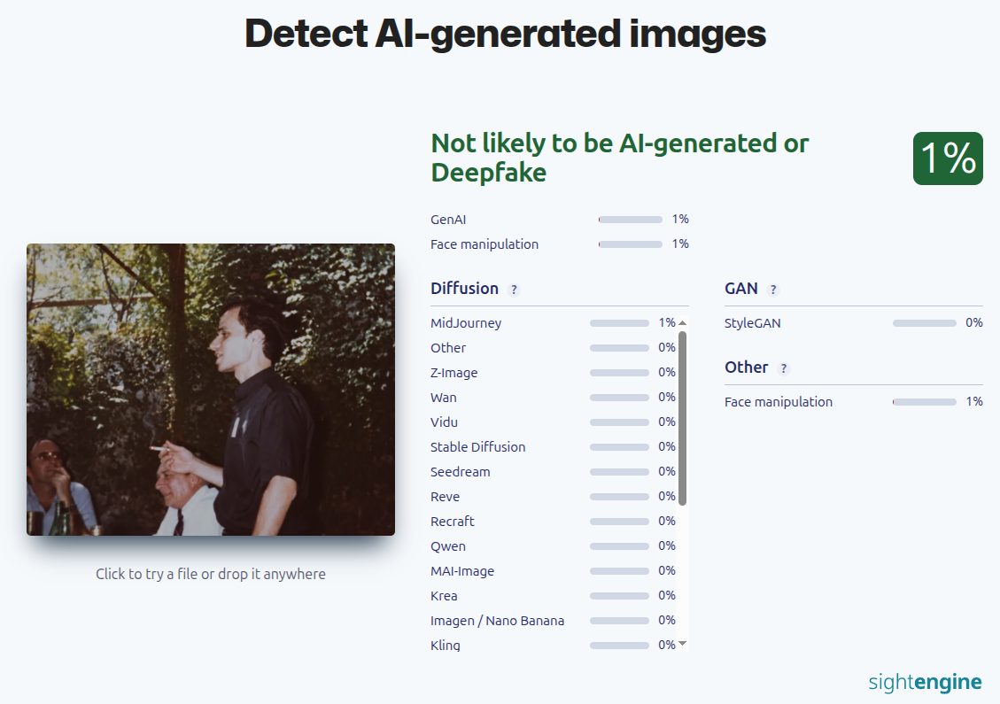
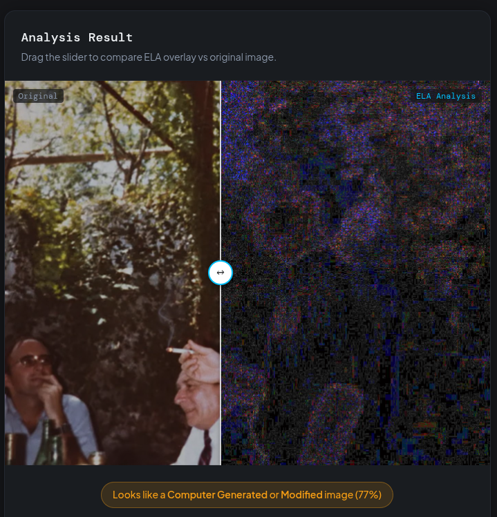

### Верифікаційний звіт.

**Обєкт:** Pope smoke

**Дата аналізу:** 18.10.2026 

1. Джерело: X (Twitter)

2. Метадані: 

**exiftool**
ExifTool Version Number         : 13.50

File Name                       : pope_smoke.jpeg

Directory                       : .

File Size                       : 168 kB

File Modification Date/Time     : 2026:10:18 21:14:37+03:00

File Access Date/Time           : 2026:10:18 21:17:03+03:00

File Inode Change Date/Time     : 2026:10:18 21:17:02+03:00

File Permissions                : -rw-rw-r--

File Type                       : JPEG

File Type Extension             : jpg

MIME Type                       : image/jpeg

JFIF Version                    : 1.01

Resolution Unit                 : None

X Resolution                    : 1

Y Resolution                    : 1

Image Width                     : 1408

Image Height                    : 1117

Encoding Process                : Progressive DCT, Huffman coding

Bits Per Sample                 : 8

Color Components                : 3

Y Cb Cr Sub Sampling            : YCbCr4:2:0 (2 2)

Image Size                      : 1408x1117

Megapixels                      : 1.6

**c3p**

No C2PA Data Found
 
File: pope_smoke.jpeg
 
Format: JPEG Image (✅ Supported)

This file doesn't contain C2PA provenance information. This could mean:
 
• The file wasn't created with C2PA-enabled tools
 
• The C2PA data was removed during editing
 
• The content was saved without preserving metadata

3. Сигнал: якщо дивитись на сигнали помилок, то можемо помітити яскраві 

4. Візуально: На самому фото світло від запаленої цигарки дуже яскраве, не дивлячись на рік зйомки. Також на фото по рівням помилок є два артефакти яскварі на цигарці. Також, якщо збільшувати дим, то можна помітити артефакти по розмиттю диму.

5. Детектори: 

**Hive:**

**SightEngine:**

**fakeimagedetector**

Можна зробити висновок, що фото не є генерованим ШІ, але мало певні маніпуляції.

6. Контекст: У жовтні 2026 року, коли з'явилися новини про операцію понтифіка через легеневу пухлину, у мережі миттєво завірусилася стара фотографія, де майбутній Папа Лев XIV (Роберт Прево) нібито курить у молодості.

Вердикт: змінено.

Впевненість: середня