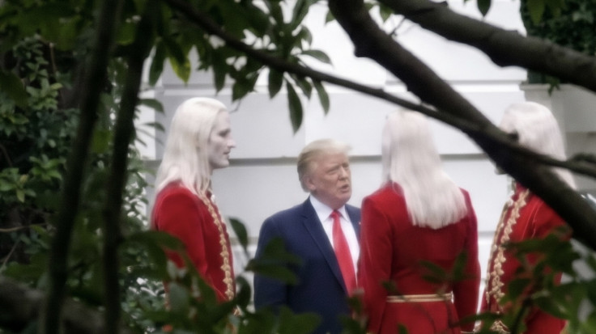
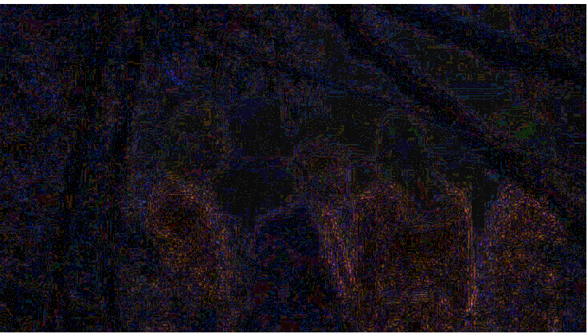
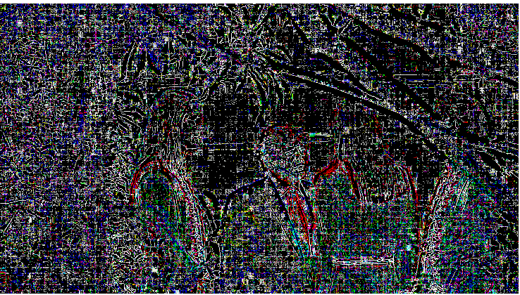
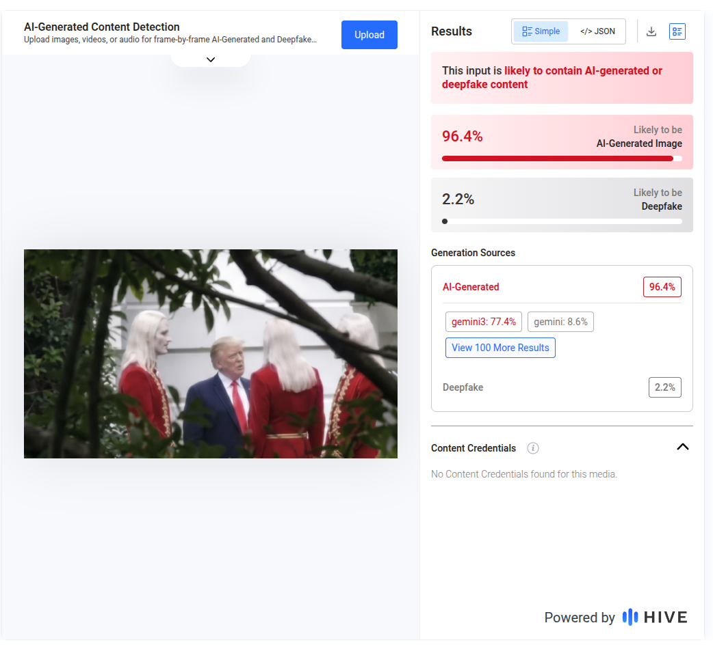
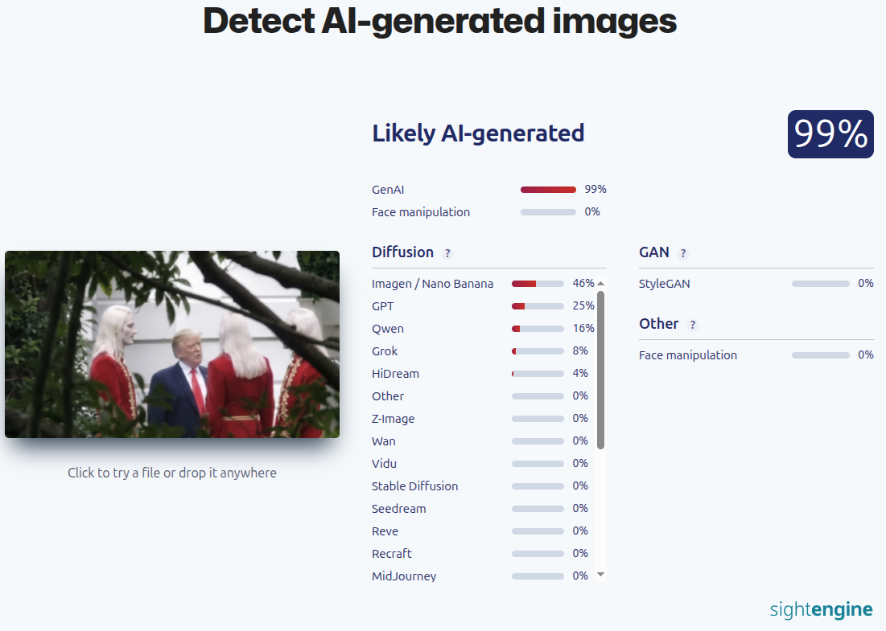

### Верифікаційний звіт.

**Обєкт:** Trump with Aliens

**Дата аналізу:** 18.10.2026

1. Джерело: r/SipsTea meme subreddit by a Reddit user (@National_Basket_)

2. Метадані: 

**ExifTool**

ExifTool Version Number         : 13.50

File Name                       : trump-photo-red-clad-group.jpg

Directory                       : .

File Size                       : 72 kB

File Modification Date/Time     : 2026:10:18 22:31:19+03:00

File Access Date/Time           : 2026:10:18 22:31:53+03:00

File Inode Change Date/Time     : 2026:10:18 22:31:50+03:00

File Permissions                : -rw-rw-r--

File Type                       : JPEG

File Type Extension             : jpg

MIME Type                       : image/jpeg

JFIF Version                    : 1.01

Resolution Unit                 : inches

X Resolution                    : 96

Y Resolution                    : 96

Comment                         : CREATOR: gd-jpeg v1.0 (using IJG JPEG v80), quality = 90.

Image Width                     : 736

Image Height                    : 413

Encoding Process                : Baseline DCT, Huffman coding

Bits Per Sample                 : 8

Color Components                : 3

Y Cb Cr Sub Sampling            : YCbCr4:4:4 (1 1)

Image Size                      : 736x413

Megapixels                      : 0.304

3. Сигнал:  

Рівень помилок:

Рівень шуму:

4. Візуально:  При перегляді фото модна помітити розмиття гілки на передніоьму плані. Також уніформа червоного кольору та довге біле волосся фігур не мають нічого спільного з реальним виглядом королівської гвардії Норвегії.

5. Детектори:

**Hive:**

**SightEngine:**

6. Контекст: ефекту «витоку секретних матеріалів» або випадкового кадру папараці під час дипломатичної зустрічі.

Вердикт: згенероване

Впевненість: Висока.