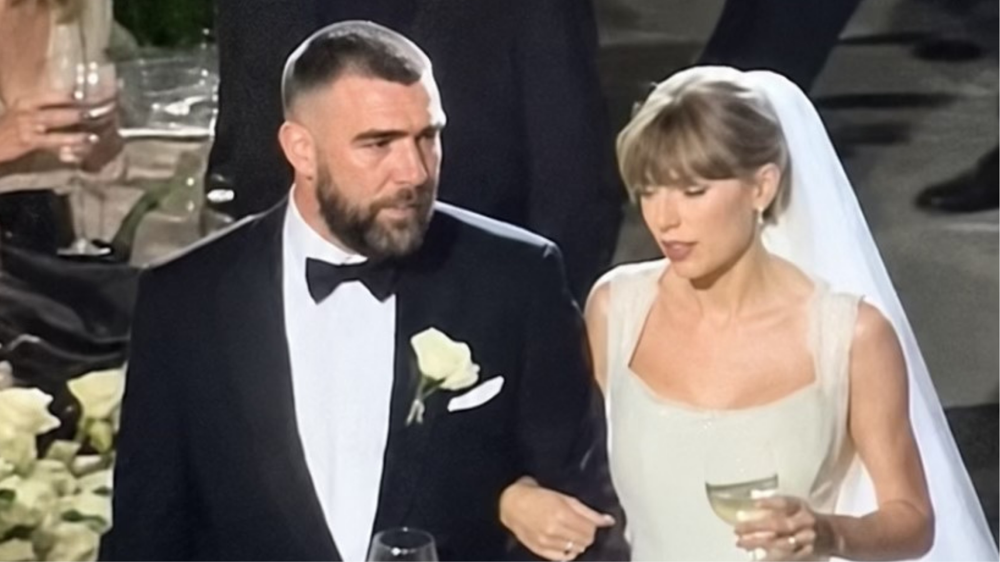
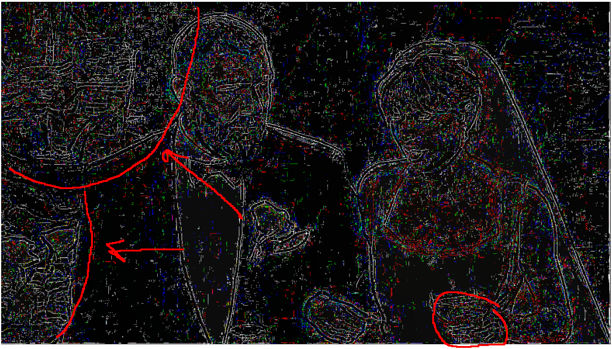
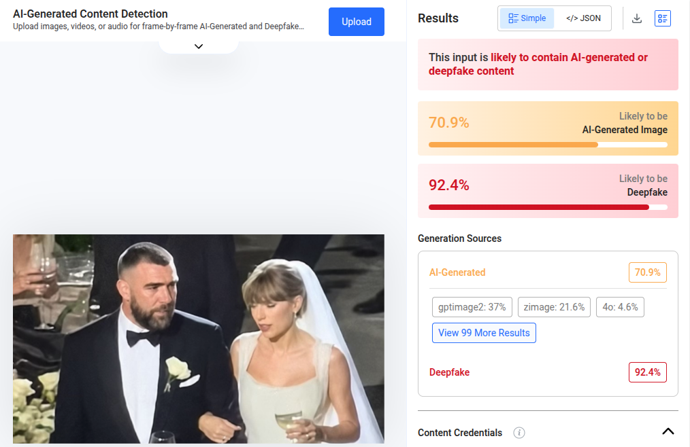
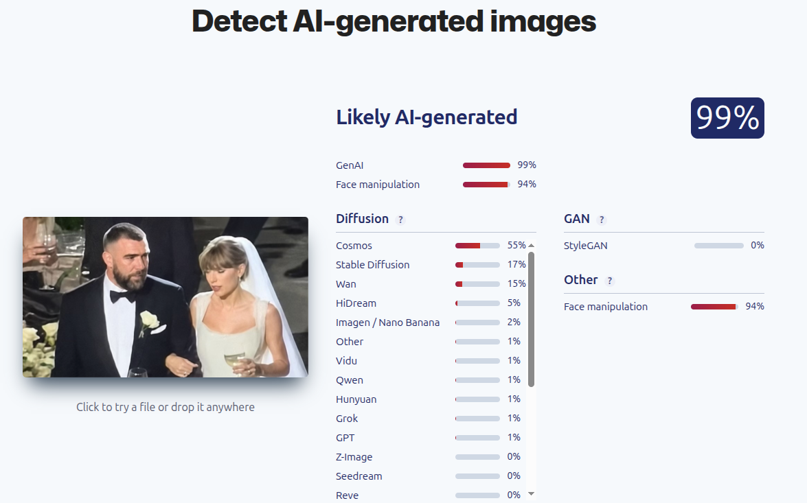

### Верифікаційний звіт.

**Обєкт:** taylor_swift_ai_pic_feature.png

**Дата аналізу:** 18.10.2026 

1. Джерело: TikTok, Instagram та Facebook

2. Метадані: 

**ExifTool**

ExifTool Version Number         : 13.50

File Name                       : taylor_swift_ai_pic_feature.png

Directory                       : .

File Size                       : 32 kB

File Modification Date/Time     : 2026:10:17 22:20:26+03:00

File Access Date/Time           : 2026:10:17 22:58:51+03:00

File Inode Change Date/Time     : 2026:10:17 22:20:33+03:00

File Permissions                : -rw-rw-r--

File Type                       : WEBP

File Type Extension             : webp

MIME Type                       : image/webp

VP8 Version                     : 0 (bicubic reconstruction, normal loop)

Image Width                     : 1200

Horizontal Scale                : 0

Image Height                    : 675

Vertical Scale                  : 0

Image Size                      : 1200x675

Megapixels                      : 0.810

**c2pviewer.com**

No C2PA Data Found

File: taylor_swift_ai_pic_feature.png

Format: WebP Image (✅ Supported)

This file doesn't contain C2PA provenance information. This could mean:

• The file wasn't created with C2PA-enabled tools

• The C2PA data was removed during editing

• The content was saved without preserving metadata

Try uploading a file from a supported camera or software, or test with our sample images below.

3. Сигнали:

4. Візуально: Якщо придивитися до рук (особливо до пальців лівої руки Свіфт, якою вона тримає келих, та руки, що лежить на лікті Келсі), помітні неприродні пропорції та спотворення суглобів. Крім того, об'єкти на задньому плані ліворуч (келихи та руки іншої людини) розмиті й деформовані в типовий для генеративних моделей спосіб.

5. Детектори:

**Hive:**

**SightEngine:**

6. В той момент було багато фото з весілля і всі вони відрізнялись одігом головних героїв, відвідувачі завжди були непропорційні та замилені.

Вердикт: згерероване.

Впевненість: висока.
