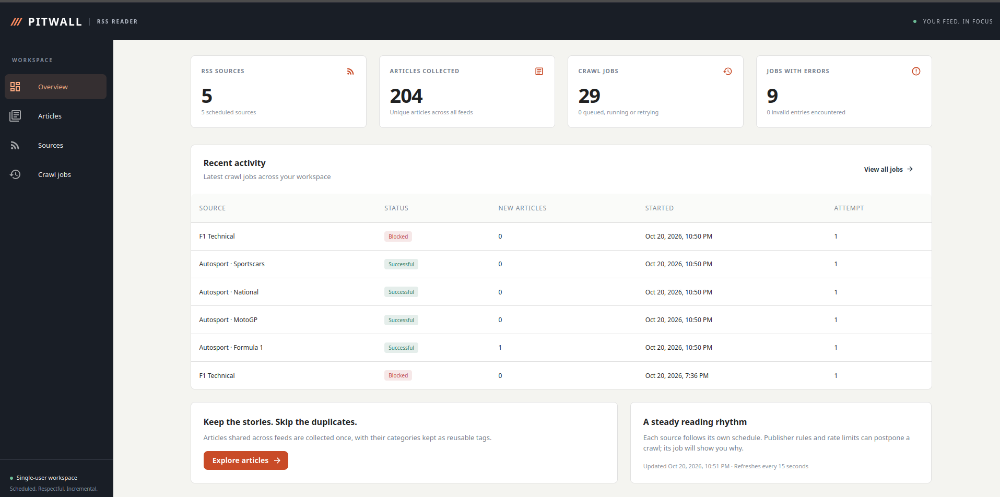
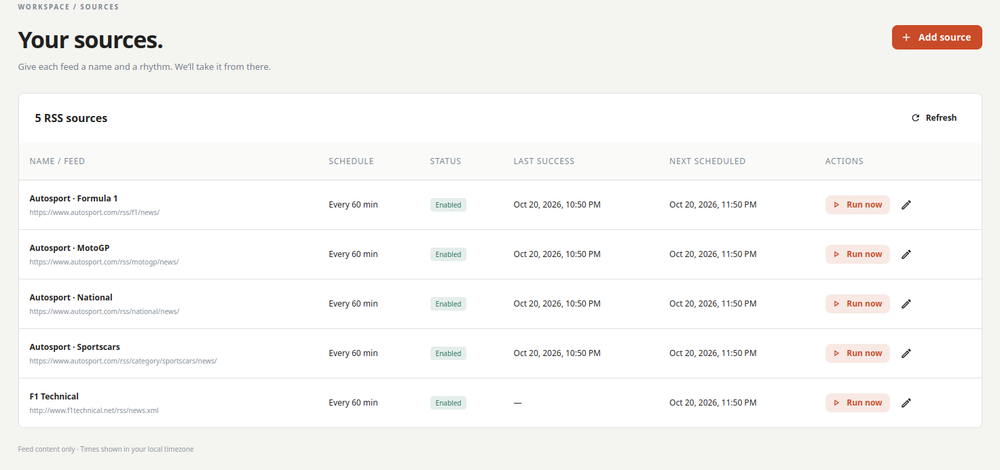
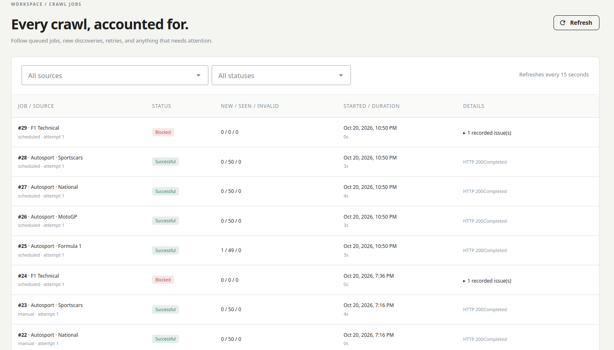
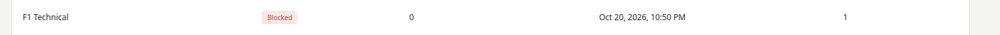

## Звіт.

Даний проект має 4 сторінки. 

**Overview** - містить загальну інформацію про проект. Це загальна кількість джерел, кількість зібраних данних, а також інші ключові показники.

**Articles** - відображає список всіх статей, зібраних з різних джерел, з можливістю перегляду детальної інформації по кожній статті.

**Sources** - відображає список всіх джерел, які використовуються в проекті, з можливістю перегляду детальної інформації по кожному джерелу.

**Crawl jobs** - відображає список всіх завдань збирання даних, з можливістю перегляду детальної інформації по кожному завданню, включаючи статус виконання та час останнього запуску.

Сайт має має 4 джерела. Перідом збору даних за замовчуванням є 60 хвилин. Є налаштування для зміни цього періоду. Також є можливість запуску збору даних вручну.

Спостереження:
- в налаштуваннях можна додати параметри проксі сервера для тих випадків, якщо в певний момент джерело заблокує доступ до сайту. В такому випадку збір даних буде здійснюватися через проксі. Також, краще робити масив проксі серверів для їх ротації. Можна застомувати Tor, але в певних випадках його також можуть заблокувати, тому що всі знають його IP-адреси.
- одне джерело в моєму випадку є заблокованим, тому що файл robots.txt забороняє доступ до нього. Це можна обійти змінивши параметр User-Agent. Можемо також зробити масив User-Agent для ротації, щоб уникнути блокування.

- важливо також враховувати, що деякі сайти можуть використовувати додаткові механізми захисту, такі як CAPTCHA або обмеження по IP, тому в таких випадках може знадобитися додаткова обробка або використання спеціалізованих сервісів для обходу цих обмежень.

