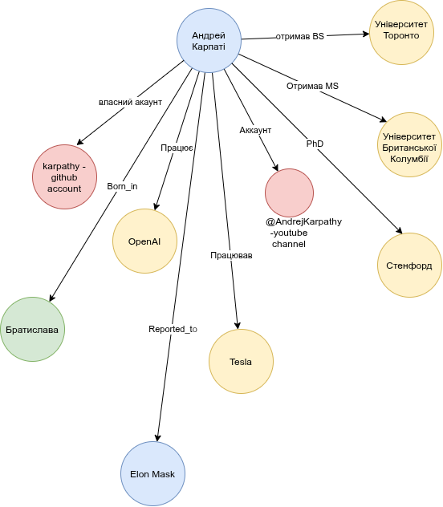

# Lesson Homework 5 — Entity Resolution: Андрей Карпаті (Andrej Karpathy)

**Об'єкт:** Andrej Karpathy, дослідник ШІ, публічна особа. Тільки публічна діяльність і відкриті джерела. Дані з витоків не використовувалися. Дата збору: 2026-10-24.

## Завдання 1 — Таблиця ідентифікаторів

| # | Ідентифікатор | Значення | Джерело | Впевненість (1–10) |
|---|---------------|----------|---------|--------------------|
| 1 | Повне ім'я | Andrej Karpathy (народився 23.10.1986, Братислава; словацько-канадський) | [Wikipedia](https://en.wikipedia.org/wiki/Andrej_Karpathy), [Wikidata Q56037405](https://www.wikidata.org/wiki/Q56037405), особистий сайт [karpathy.ai](https://karpathy.ai), [Axios](https://www.axios.com/2026/05/19/anthropic-openai-karpathy-andrej-claude) | **10** |
| 2 | Нікнейм | `karpathy` (X/Twitter) | Особистий сайт karpathy.ai (сайт посилається на цей акаунт); GitHub-профіль посилається на той самий X-акаунт; Axios цитує його пост звідти | **10** |
| 3 | Нікнейм | `karpathy` (GitHub; у профілі: "I like to train Deep Neural Nets on large datasets.") | [github.com/karpathy](https://github.com/karpathy), підтверджено посиланням з karpathy.ai | **10** |
| 4 | Нікнейм | `@AndrejKarpathy` (YouTube) | Посилання з karpathy.ai. Сторінку каналу не вдалося прочитати автоматично, тому підтвердження одне | **8** |
| 5 | Нікнейм (старий) | `badmephisto` (ранній YouTube-канал) | Wikipedia. Одне джерело, без перехресного підтвердження | **6** |
| 6 | Нікнейм / ID | Google Scholar `l8WuQJgAAAAJ` | karpathy.ai | **9** |
| 7 | Компанія (поточна) | Anthropic, команда pretraining (з 19.05.2026) | [Axios](https://www.axios.com/2026/05/19/anthropic-openai-karpathy-andrej-claude), [The New Stack](https://thenewstack.io/andrej-karpathy-anthropic-pretraining/), Wikipedia, його власний пост у X, переказаний у цих ЗМІ | **9** |
| 8 | Компанія (власна) | Eureka Labs, LLC (Delaware, 21.06.2024; зареєстрована в Каліфорнії, № 202462719919; керуючий — Karpathy; діяльність призупинена на час роботи в Anthropic) | [TechCrunch](https://techcrunch.com/2024/07/16/after-tesla-and-openai-andrej-karpathys-startup-aims-to-apply-ai-assistants-to-education/), агрегатор реєстру штату Каліфорнія [bizprofile.net](https://www.bizprofile.net/ca/san-francisco/eureka-labs-llc) | **8** |
| 9 | Компанія (історична) | OpenAI (2015–2017, 2023–2024); Tesla, директор з ШІ (2017–2022) | Wikipedia, ЗМІ | **9** |
| 10 | Адреса | 548 Market St, San Francisco, CA 94104 (principal address Eureka Labs LLC; поштова: PMB 87425) | bizprofile.net (агрегатор даних Secretary of State CA). Первинний реєстр не перевірявся. Адреса значиться як principal для 144 компаній, тобто це virtual mailbox | **6** (як адреса компанії), **2** (як місце перебування особи) |
| 11 | Адреса (локація) | San Francisco, CA | LinkedIn-профіль ([andrej-karpathy-9a650716](https://www.linkedin.com/in/andrej-karpathy-9a650716/)). Сніпет застарілий, показує Tesla/Stanford | **6** |
| 12 | Освіта | Univ. of Toronto (BSc, 2009), UBC (MSc, 2011), Stanford (PhD, 2015, науковий керівник Fei-Fei Li) | Wikipedia, karpathy.ai | **9** |
| 13 | Email | Не знайдено. На karpathy.ai є іконка "click to reveal", адреса у відкритому тексті відсутня | karpathy.ai | **n/a** |
| 14 | Телефон | Не знайдено у публічних джерелах | — | **n/a** |

### Чому так оцінено

Шкала:
- **10** — підтверджено щонайменше двома незалежними первинними або авторитетними джерелами, з перехресними посиланнями.
- **8–9** — одне первинне джерело плюс ЗМІ або вторинне підтвердження.
- **6–7** — одне джерело, або агрегатор без перевірки первинного реєстру.
- **≤ 3** — значення формально правдиве, але не ідентифікує особу.

## Джерела

- <https://karpathy.ai>
- <https://github.com/karpathy>
- <https://en.wikipedia.org/wiki/Andrej_Karpathy>
- <https://www.wikidata.org/wiki/Q56037405>
- <https://www.axios.com/2026/05/19/anthropic-openai-karpathy-andrej-claude>
- <https://thenewstack.io/andrej-karpathy-anthropic-pretraining/>
- <https://techcrunch.com/2024/07/16/after-tesla-and-openai-andrej-karpathys-startup-aims-to-apply-ai-assistants-to-education/>
- <https://www.bizprofile.net/ca/san-francisco/eureka-labs-llc>
- <https://www.linkedin.com/in/andrej-karpathy-9a650716/>

## Завдання 2 — Graph

Джерела взяті з розділу "Джерела" вище.

## Завдання 3 — Collision Detection

**Альтернативна гіпотеза:** "записи під іменем Andrej Karpathy належать не одній людині".

### 1. Скільки людей з таким іменем знайшлося у відкритих джерелах?

**Щонайменше 3, підтверджена особа лише одна.**

| Хто | Доказ | Статус |
|-----|-------|--------|
| Andrej Karpathy, дослідник ШІ (1986, Братислава) | Wikipedia, Wikidata Q56037405, karpathy.ai, ЗМІ | Наша особа |
| Два інші профілі "Andrej Karpathy" | Блок "Others Named Andrej Karpathy" на [Facebook-сторінці](https://www.facebook.com/karpathy/). Деталей у видачі немає | Не досліджені. Зв'язку з нашою особою не виявлено |
| Схожі акаунти (`@karpathytwo`, `@andrej_karpathy`, `@KarpathyAn31813`; Instagram-варіанти `@andrej.karpathy`, `@karpathy.andrej`, `@karpathy.a`, `@a.karpathy`) | [IDCrawl](https://www.idcrawl.com/andrej-karpathy), пошукова видача | Власники не встановлені. Це можуть бути копії, фанати або тезки |

Обмеження підрахунку:
- Це нижня межа, а не повний перепис. Facebook і Instagram за потрібними сторінками я не відкривав.
- IDCrawl показує "1 особа". Це результат агрегатора, який міг об'єднати різних людей, тому такому числу я не довіряю.
- Інші люди з прізвищем Karpathy (без імені Andrej) існують, але під ім'я не підпадають, тому їх не рахував.

### 2. Які 2 факти однозначно ідентифікують саме цю людину?

1. **Біографічна пара: Stanford PhD (2015) під керівництвом Fei-Fei Li і роль співзасновника/founding member OpenAI.** Обидва факти є у Wikipedia та на karpathy.ai, а ЗМІ (Axios, TechCrunch) повторюють їх незалежно. Збіг цих двох подій в одного Andrej Karpathy практично неможливий.
2. **Замкнений ланцюг посилань від особистого сайту.** karpathy.ai веде на `@karpathy` (X), `karpathy` (GitHub), `@AndrejKarpathy` (YouTube) і Google Scholar `l8WuQJgAAAAJ`, а GitHub-профіль посилається назад на X. Такі посилання контролює сам власник, тому їх не можна підробити копією акаунта.

Дата і місце народження (23.10.1986, Братислава) також підходять, але вони лише з Wikipedia і Wikidata. Незалежного підтвердження немає, тому як опору я їх не беру.

### 3. Який зв'язок я б не включив через ризик collision?

Не включив би **LinkedIn-профіль** [andrej-karpathy-9a650716](https://www.linkedin.com/in/andrej-karpathy-9a650716/) (рядок 11 таблиці, "San Francisco").

Причини:
- karpathy.ai прямо вказує, що LinkedIn у нього не listed, тобто власник сам цей профіль не підтверджує.
- Видача показує застарілі дані (Tesla, Stanford, 280 зв'язків), а профіль міг бути створений і покинутий.
- ID Wikidata вказує на цей профіль, але Wikidata редагується спільнотою, це не підтвердження власника.
- Зв'язок з іншими записами лише за збігом імені, а ім'я якраз і є ризиком collision.

У таблиці Завдання 1 він має 6/10 лише для локації. В граф його варто додавати з позначкою "не підтверджено" або не додавати зовсім.

Також не включив би:
- **Instagram-варіанти імені** (`@andrej.karpathy` та інші). Підтверджений акаунт один: `@karpathy`.
- **Адресу 548 Market St як зв'язок "людина — місце".** Це поштова скринька 144 компаній, будь-яка з них могла б з'явитися в тому самому місці.
- **Псевдонім `badmephisto`.** Він є лише у Wikipedia. Без другого джерела зв'язок з нашою особою не можна вважати надійним.

### Висновок

Колізія для цього імені реальна (щонайменше два інших профілі та кілька копій акаунтів), але ідентифікація стійка. Вона тримається на посиланнях, які контролює сам власник, і на біографічних фактах із кількох незалежних джерел. Усе, що тримається тільки на збігу імені, я не включаю.

